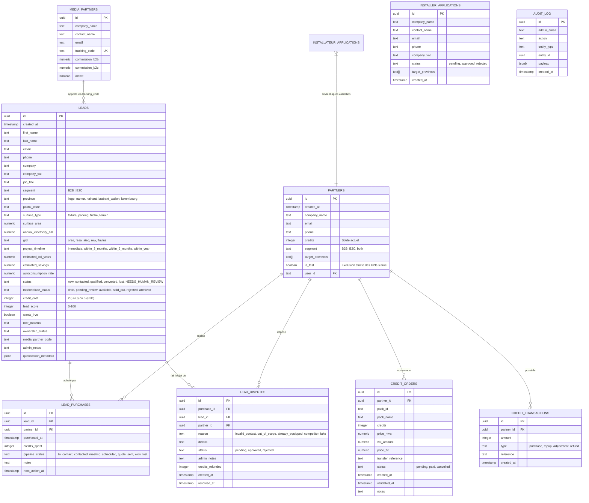

# DOSSIER D'AUDIT TECHNIQUE & PROMPT MAÎTRE
## OPTIMISATION EXTRÊME DES PERFORMANCES SUPABASE / NEXT.JS & REFONTE UI/UX DES DASHBOARDS
**Projet** : Aegis Solaire (Plateforme SaaS & Marketplace Solaire B2B/B2C en Wallonie, Belgique)  
**Stack** : Next.js 16 (App Router, Turbopack), React 19, Supabase (PostgreSQL, PostgREST, RLS), Tailwind CSS 4, Radix UI, Framer Motion, Lucide Icons, Sonner.

---

## GUIDE D'UTILISATION POUR L'UTILISATEUR

1. **Copiez l'intégralité de ce document** (ou téléchargez-le et uploadez-le directement en pièce jointe) dans le chat de votre modèle d'IA ultra-puissant (Claude 3.7 Sonnet / GPT-4o / O3 / Gemini 1.5 Pro).
2. **Laissez le modèle exécuter son audit** selon le prompt système fourni dans la **PARTIE 1**.
3. **Récupérez sa réponse** contenant les directives précises numérotées (`[ID-PERF-DB-xx]`, `[ID-PERF-NEXT-xx]`, `[ID-UX-ADMIN-xx]`, `[ID-UX-PARTNER-xx]`).
4. **Collez la réponse directement dans notre session Antigravity** : je lirai les directives et implémenterai immédiatement et chirurgicalement le code (migrations SQL Supabase, Server Components Next.js 16, procédures stockées, découpage modulaire, refonte UI/UX).

---

# PARTIE 1 : LE PROMPT SYSTÈME MAÎTRE (À TRANSMETTRE À L'IA)

```markdown
Tu es un collège de 3 sommités mondiales de l'ingénierie logicielle :
1. Principal Database Architect & PostgreSQL / Supabase Performance Fellow (expert en requêtage PostgREST, plans d'exécution EXPLAIN ANALYZE, indexation B-Tree / GIN trigramme, procédures stockées PL/pgSQL, agrégations côté moteur, élimination des N+1 queries, et isolation des transactions).
2. Principal Next.js 16 / React 19 Fullstack Engineer (expert en App Router, Server Components vs Client Components, Suspense Streaming, TTFB reduction, Server Actions, unstable_cache / revalidateTag, et élimination des waterfalls réseau).
3. VP of Product Design & SaaS UX/UI Architect (expert en ergonomie d'outils B2B et de places de marché financières, densité de données, flux de qualification rapide de leads, ergonomie mobile pour techniciens/installateurs sur le terrain, micro-interactions et accessibilité WCAG AA).

### CONTEXTE DU PROJET
Aegis Solaire est la plateforme de référence en Wallonie (Belgique) pour la qualification et la monétisation de leads solaires (B2B toitures & ombrières de parking, B2C résidentiel).
Le projet comporte 3 espaces dashboards majeurs :
1. Dashboard Administrateur (`/admin/dashboard` & `/admin/leads`) : pilotage des leads entrants, validation des leads avant publication sur la marketplace, gestion des candidatures installateurs et apporteurs, validation manuelle des commandes de crédits, traitement des litiges (garantie 24h ouvrées), journal d'audit.
2. Dashboard Partenaires Installateurs (`/partenaires/dashboard` & `/partenaires/dashboard/credits`) : feed marketplace en temps réel avec exclusivité / créneaux (1 seul installateur en B2B, max 3 en B2C), achat de leads par crédits, mini-CRM pipeline (À contacter, RDV fixé, Devis envoyé, Gagné, Perdu), gestion des litiges, rechargement de crédits via virement SEPA.
3. Dashboard Prescripteurs / Media Partners (`/media-partners/dashboard`) : tracking de code affilié, statistiques d'attribution et calcul des commissions dues.

### LA PROBLÉMATIQUE TECHNIQUE MAJEURE
Actuellement :
1. Sur le Dashboard Admin : le chargement déclenche **19 requêtes Supabase distinctes en parallèle via `Promise.all`** sur PostgREST (comptages exacts sans cache PostgreSQL, récupération de données pour faire des `filter` et `reduce` en mémoire JavaScript : calcul du taux d'écoulement, exclusion des comptes de test, calcul des commissions). Le TTFB est lourd et le serveur subit une latence réseau inutile (19 allers-retours HTTP).
2. Sur le Dashboard Partenaire : le composant principal fait **2 381 lignes de code client (`use client`)**, pèse plus de 107 KB et déclenche au montage 4 appels `fetch()` distincts (`/api/partners/marketplace`, `/api/partners/credits`, `/api/partners/preferences`, `/api/partners/marketplace/ticker`), affichant un écran blanc avec loader avant d'afficher quoi que ce soit (aucun SSR ni Suspense streaming).
3. Sur la Gestion des Leads (`/admin/leads`) : la recherche plein texte utilise `query.or('email.ilike.%q%,first_name.ilike.%q%...')` sans index trigramme GIN, et chaque pagination recalcule un `count: 'exact'` sur toute la table, ce qui ralentit la navigation au fur et à mesure que le volume grandit.
4. Sur l'UI/UX : l'administrateur a besoin d'une "Tour de Contrôle" ultra-rapide (triage des actions requises en 1 clic, réclamations en attente, commandes de crédits à valider, qualification express) et l'installateur a besoin d'un pipeline CRM fluide (Kanban ou liste ultra-ergonomique avec boutons d'appel/WhatsApp immédiats sur mobile).

### TES OBJECTIFS D'AUDIT & FORMAT DE RESTITUTION
Fournis un plan d'action d'ingénierie chirurgical, divisé en 4 axes prioritaires. Chaque point doit impérativement respecter la nomenclature suivante :

`[ID-CATÉGORIE-NUMÉRO] [Priorité: P0-Critique | P1-Important | P2-Amélioration] Titre clair`
- **Fichier(s) ou Ressource(s) concerné(s)** : (Chemin exact du fichier ou script SQL)
- **Diagnostic & Goulot d'étranglement** : (Explication technique de la latence, de la surcharge réseau, ou de la friction UX)
- **Spécification Technique & Solution Concrète** : (Code SQL complet prêt à exécuter, fonction Next.js RSC / API route optimisée, composant découpé, ou diff React 19)
- **Bénéfice mesurable attendu** : (Gain de TTFB en ms, réduction de charge CPU/DB, suppression de requêtes réseau, fluidité UX)

Voici les 4 axes à traiter obligatoirement :
1. **AXE 1 : PERFORMANCES DATABASE & POSTGRESQL (Supabase)**
   - Remplacement des 19 requêtes Supabase du dashboard par **une seule procédure stockée SQL (`get_admin_dashboard_kpis()`)** renvoyant un JSON agrégé en <20ms.
   - Script d'indexation complet (index composés B-Tree, index partiels pour les statuts critiques, et index GIN `pg_trgm` pour la recherche instantanée de leads sans scan séquentiel).
   - Optimisation des transactions d'achat de leads pour éliminer tout risque de race condition sur les créneaux.
2. **AXE 2 : ARCHITECTURE NEXT.js 16, CACHE & STREAMING**
   - Refonte du chargement des données : passage en React Server Components (RSC) natifs avec `Suspense` et skeletons skeleton-UI pour un First Contentful Paint instantané.
   - Stratégie de revalidation granulaire avec `unstable_cache` et tags ciblés (`revalidateTag("admin-kpis")`, `revalidateTag("marketplace-feed")`) déclenchés uniquement lors des mutations (achats, validation de crédits, publication).
   - Élimination des cascades `fetch()` dans le dashboard partenaire grâce au préchargement côté serveur ou à un endpoint agrégé unique (`/api/partners/dashboard-init`).
3. **AXE 3 : DÉCOUPAGE MODULAIRE DU CLIENT PARTENAIRES (107 KB -> Modulaire)**
   - Plan de découpage du composant monolithique de 2 381 lignes (`app/partenaires/dashboard/page.tsx`) en sous-composants autonomes et légers : Modale Litige, Modale Préférences/Alertes, Modale Packs Crédits, Table Feed Marketplace, Tiroir CRM Pipeline.
4. **AXE 4 : EXPÉRIENCE UTILISATEUR (UI/UX) & DENSITÉ D'INFORMATION**
   - Admin : Création d'un "Plateau de Décision Rapide" (Action Required Tray) regroupant en tête de page : commandes de crédits à valider, litiges 24h en attente, leads à revoir, candidatures à approuver.
   - Admin Leads Table : Raccourcis clavier (Navigation J/K, Ouvrir détail Entrée, Valider/Publier P), filtres rapides "En 1 clic" (Non assignés, B2B haute valeur, Litiges).
   - Installateur Partenaire : Expérience CRM hybride (Mode Liste dense & Mode Pipeline Kanban avec glisser-déposer ou boutons de statut 1-tap), affichage optimisé mobile pour techniciens sur chantier (boutons d'appel `tel:`, WhatsApp pré-rempli, export vCard natif).

Prends connaissance de l'ensemble du dossier technique ci-dessous avant de délivrer ton audit.
```

---

# PARTIE 2 : LE DOSSIER DE CONTEXTE TECHNIQUE & ARCHITECTURE

## 1. SCHÉMA DE LA BASE DE DONNÉES (TABLES MAJEURES SUPABASE)



---

## 2. LE FLUX ACTUEL DU DASHBOARD ADMIN & SES GOULOTS D'ÉTRANGLEMENT

### Fichier actuel : `app/admin/(dashboard)/dashboard/page.tsx`
Dans l'état actuel du code, chaque appel à la page (avec revalidation toutes les 20 secondes) lance **19 requêtes Supabase** en parallèle via `Promise.all` :

```typescript
// Extrait exact de app/admin/(dashboard)/dashboard/page.tsx
const getStatsCached = unstable_cache(
  async () => {
    const supabase = createServiceRoleClient()
    const now = new Date()
    const startOfMonth = new Date(now.getFullYear(), now.getMonth(), 1)
    const startOfDay = new Date(now.getFullYear(), now.getMonth(), now.getDate())

    const [
      leadsCountRes,           // 1. SELECT count(*) FROM leads
      leadsMonthRes,           // 2. SELECT count(*) FROM leads WHERE created_at >= startOfMonth
      leadsTodayRes,           // 3. SELECT count(*) FROM leads WHERE created_at >= startOfDay
      leadsB2BRes,             // 4. SELECT count(*) FROM leads WHERE segment = 'B2B'
      leadsB2CRes,             // 5. SELECT count(*) FROM leads WHERE segment = 'B2C'
      leadsAvailableRes,       // 6. SELECT id, segment, credit_cost FROM leads WHERE marketplace_status = 'available'
      leadsSoldRes,            // 7. SELECT count(*) FROM leads WHERE marketplace_status = 'sold_out'
      leadsNeedsReviewRes,     // 8. SELECT * FROM leads WHERE marketplace_status = 'pending_review' LIMIT 10
      leadsNewStatusRes,       // 9. SELECT count(*) FROM leads WHERE status = 'new'
      leadsQualifiedRes,       // 10. SELECT count(*) FROM leads WHERE status = 'qualified'
      recentLeadsRes,          // 11. SELECT * FROM leads ORDER BY created_at DESC LIMIT 15
      installerAppsRes,        // 12. SELECT count(*) FROM installer_applications WHERE status = 'pending'
      partnersRes,             // 13. SELECT * FROM partners (TOUS les partenaires ramenés en mémoire pour filter is_test!)
      purchasesRes,            // 14. SELECT * FROM lead_purchases (TOUS les achats ramenés pour calculer sell-through rate!)
      mediaPartnersRes,        // 15. SELECT * FROM media_partners
      attributedLeadsRes,      // 16. SELECT * FROM leads WHERE media_partner_code IS NOT NULL (boucle JS pour commissions!)
      auditLogsRes,            // 17. SELECT * FROM audit_log ORDER BY created_at DESC LIMIT 10
      creditOrdersRes,         // 18. SELECT * FROM credit_orders ORDER BY created_at DESC LIMIT 100
      disputesRes              // 19. SELECT * FROM lead_disputes WHERE status = 'pending' LIMIT 5
    ] = await Promise.all([ ... ])

    // Post-traitement lourd en mémoire JavaScript :
    // - Somme des crédits disponibles
    // - Filtrage des partenaires non-test
    // - Calcul du sell-through rate avec Set()
    // - Calcul des commissions d'apporteurs d'affaires avec boucle imbriquée
    // - Calcul des totaux HTVA et TTC des commandes en attente
    ...
```

### Problèmes identifiés :
1. **Saturation de la bande passante et latence** : 19 requêtes HTTP PostgREST vers Supabase pour une seule page. Sur serveur serverless / Edge, cela peut ajouter 400 à 900ms de latence cumulée.
2. **Transfert massif de lignes inutiles** : Toutes les lignes de `partners`, `lead_purchases` et `credit_orders` sont téléchargées en Node.js pour faire de simples additions (`reduce`) et exclusions (`filter`).
3. **Le Layout Admin (`app/admin/(dashboard)/layout.tsx`) ajoute 4 requêtes supplémentaires** pour calculer les badges de la barre latérale (`installer_applications`, `media_partner_applications`, `leads.pending_review`, `credit_orders.pending`).

---

## 3. LA GESTION DES LEADS ADMIN & RECHERCHE

### Fichier actuel : `app/admin/(dashboard)/leads/page.tsx`
```typescript
// Extrait de app/admin/(dashboard)/leads/page.tsx
let query = supabase
  .from("leads")
  .select("id, first_name, last_name, email, phone, job_title, company, ...", { count: "exact" })
  .order("created_at", { ascending: false })
  .range(from, from + limit - 1)

if (filters.search.trim()) {
  const q = `%${filters.search.trim()}%`
  query = query.or(`email.ilike.${q},first_name.ilike.${q},last_name.ilike.${q},company.ilike.${q},company_vat.ilike.${q}`)
}

if (filters.region) {
  // REQUÊTE SÉQUENTIELLE PRÉALABLE !
  const { data: instIds } = await supabase.from("installateurs").select("id").eq("region", filters.region)
  const ids = (instIds ?? []).map((i) => i.id)
  query = query.in("installateur_id", ids)
}
```

### Problèmes identifiés :
1. `{ count: "exact" }` sur PostgreSQL force un parcours complet d'index ou de table sur chaque filtrage, particulièrement pénalisant avec `ilike`.
2. Le `ilike` sur 5 colonnes texte sans extension `pg_trgm` provoque un **Seq Scan (Scan séquentiel complet)** de la table `leads`.
3. Le filtre par région déclenche une sous-requête applicative vers la table `installateurs` au lieu d'un simple filtrage sur la colonne `province` de la table `leads`.

---

## 4. LE DASHBOARD PARTENAIRES & FEED MARKETPLACE

### Fichier actuel : `app/partenaires/dashboard/page.tsx` (2 381 lignes, 107 KB)
- Composant 100% Client (`"use client"`).
- Au premier rendu dans le navigateur :
  ```typescript
  useEffect(() => {
    fetchMarketplace()  // -> GET /api/partners/marketplace
    fetchMyLeads()      // -> GET /api/partners/credits
    fetchPreferences()  // -> GET /api/partners/preferences
  }, [])
  ```
- **3 allers-retours HTTP asynchrones** déclenchés après que le bundle JavaScript a été téléchargé, parsé et exécuté par le navigateur client.
- L'utilisateur voit un écran vide avec un spinner tournant pendant 1 à 2 secondes.
- **Monolithe de 2 381 lignes** : contient dans un seul fichier :
  - Le feed complet des opportunités marketplace (cartes et table).
  - La gestion du portefeuille "Mes Leads Achetés".
  - Les formulaires de déclaration de litige avec radio-boutons.
  - La modale de réglage des notifications et alertes de zones.
  - La modale d'affichage des avantages de palier (Certified, Silver, Gold).
  - Le calcul du statut pipeline (À contacter, RDV, Devis, etc.).
  - La génération vCard et copie rapide.

### Fichier API Route : `app/api/partners/marketplace/route.ts`
- Exécute une requête `limit(60)` sur `leads WHERE marketplace_status = 'available'`.
- Effectue un `catch` pour tenter un fallback si certaines colonnes n'existent pas (code 42703).
- Effectue ensuite une 2ème requête sur `lead_purchases` avec `.in('lead_id', leadIds)` pour trouver qui a acheté les créneaux.
- Effectue ensuite une 3ème requête sur `lead_purchases` pour savoir quels leads le partenaire connecté a déjà achetés.
- Fait tourner en mémoire JavaScript les fonctions `evaluateLeadPublishability(lead)` et `calculateMarketplaceFinancials(...)` sur chaque lead.

---

## 5. LE DASHBOARD PRESCRIPTEURS / MEDIA PARTNERS

### Fichier actuel : `app/media-partners/(dashboard)/dashboard/page.tsx`
- Composant client qui exécute au montage :
  ```typescript
  const [statsRes, leadsRes] = await Promise.all([
    fetch(`/api/media-partners/stats?period=${p}`),
    fetch(`/api/media-partners/leads?period=${p}&page=${pg}&limit=15`),
  ])
  ```
- L'API `stats` recalcule côté serveur les commissions dues en fonction des leads attribués.

---

# PARTIE 3 : VOS DIRECTIVES TECHNIQUES ATTENDUES

Fournis maintenant votre rapport d'audit d'élite avec toutes les résolutions techniques prêtes à être appliquées :

1. **Procédure stockée SQL `get_admin_dashboard_kpis()`** : écris la fonction PL/pgSQL complète retournant en une seule ligne JSON tous les indicateurs (comptages exacts instantanés, sommes HTVA/TTC, leads en attente de révision, litiges 24h, répartition B2B/B2C, sans aucun compte de test).
2. **Script SQL d'indexation** : écris le script `CREATE INDEX IF NOT EXISTS ...` complet couvrant la table `leads`, `lead_purchases`, `credit_orders`, `lead_disputes`, et l'index GIN trigramme pour la recherche textuelle ultra-rapide.
3. **Refonte de `app/admin/(dashboard)/dashboard/page.tsx`** : montre comment appeler la fonction RPC via `supabase.rpc('get_admin_dashboard_kpis')` en Server Component avec cache taggué Next.js 16.
4. **Endpoint agrégé et streaming pour le Dashboard Partenaires** : explique comment remplacer les 3 requêtes client par une route d'initialisation unique ou un Server Component avec Suspense Skeleton.
5. **Plan de découpage modulaire du composant de 2 381 lignes** : structure exacte des dossiers/fichiers pour séparer la marketplace, le mini-CRM portefeuille, et les modales de litiges et alertes.
6. **Recommandations UI/UX concrètes** : maquettes textuelles / directives d'interface pour l'Action Required Tray, la grille de leads avec raccourcis, et la vue pipeline mobile-first.
