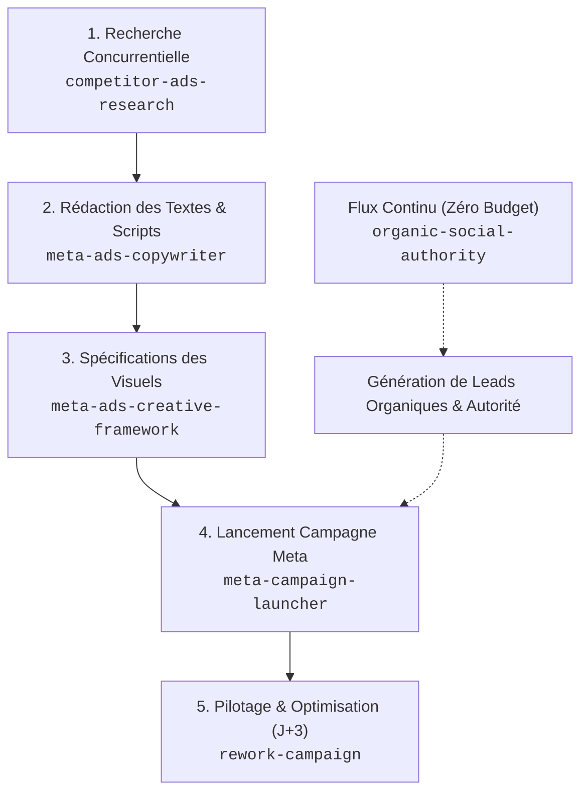

# GUIDE DES COMPÉTENCES MARKETING & ACQUISITION (SKILLS IA) — AEGIS SOLAIRE

Ce document répertorie les compétences agentiques (**Skills IA**) intégrées à votre espace de travail Aegis Solaire sous le dossier [`.agent/skills/`](file:///c:/Users/mrnat/Documents/SaaS/Aegis%20Solaire/aegis-solaire-main/.agent/skills/).

Ces compétences sont des guides méthodologiques structurés (`SKILL.md`) que votre assistant IA active à la demande pour rédiger, structurer, auditer et optimiser vos campagnes d'acquisition sans modifier une seule ligne de code de votre application.

---

## 📋 Vue d'ensemble des 6 Compétences Installées

| Nom du Skill | Dossier | Rôle & Cas d'Usage | Déclencheur Recommandé (Prompt) |
|---|---|---|---|
| **`ui-ux-pro-max`** | [`.agent/skills/ui-ux-pro-max/`](file:///c:/Users/mrnat/Documents/SaaS/Aegis%20Solaire/aegis-solaire-main/.agent/skills/ui-ux-pro-max/SKILL.md) | Intelligence de conception UI/UX (79 styles, 192 palettes, 74 polices, 119 règles UX, audit & design system). | *« Recommande un style et une palette pour notre page d'accueil solaire. »* |
| **`competitor-ads-research`** | [`.agent/skills/competitor-ads-research/`](file:///c:/Users/mrnat/Documents/SaaS/Aegis%20Solaire/aegis-solaire-main/.agent/skills/competitor-ads-research/SKILL.md) | Espionner et auditer la *Meta Ads Library* des concurrents (Otovo, Bobex, Energreen, etc.). | *« Analyse les pubs de nos concurrents solaires sur Meta Ads Library. »* |
| **`meta-ads-copywriter`** | [`.agent/skills/meta-ads-copywriter/`](file:///c:/Users/mrnat/Documents/SaaS/Aegis%20Solaire/aegis-solaire-main/.agent/skills/meta-ads-copywriter/SKILL.md) | Rédiger des packs de pubs Meta (scripts 30/60/90s + textes primaires, titres, CTA). | *« Rédige-moi 3 pubs Meta pour les propriétaires wallons. »* |
| **`meta-ads-creative-framework`** | [`.agent/skills/meta-ads-creative-framework/`](file:///c:/Users/mrnat/Documents/SaaS/Aegis%20Solaire/aegis-solaire-main/.agent/skills/meta-ads-creative-framework/SKILL.md) | Définir la direction artistique, les formats et les maquettes visuelles conformes au style suisse d'Aegis. | *« Donne-moi les spécifications visuelles pour nos créas Facebook/Instagram. »* |
| **`meta-campaign-launcher`** | [`.agent/skills/meta-campaign-launcher/`](file:///c:/Users/mrnat/Documents/SaaS/Aegis%20Solaire/aegis-solaire-main/.agent/skills/meta-campaign-launcher/SKILL.md) | Configurer la campagne dans le Business Manager (CBO vs ABO, audiences, Pixel & UTMs). | *« Guide-moi pour paramétrer notre première campagne sur Meta Ads Manager. »* |
| **`rework-campaign`** | [`.agent/skills/rework-campaign/`](file:///c:/Users/mrnat/Documents/SaaS/Aegis%20Solaire/aegis-solaire-main/.agent/skills/rework-campaign/SKILL.md) | Auditer et piloter une campagne en cours via l'arbre de décision (KILL, KEEP, SCALE, ITERATE). | *« Voici mes métriques de campagne : dis-moi quoi couper et quoi scaler. »* |
| **`organic-social-authority`** | [`.agent/skills/organic-social-authority/`](file:///c:/Users/mrnat/Documents/SaaS/Aegis%20Solaire/aegis-solaire-main/.agent/skills/organic-social-authority/SKILL.md) | Écrire des posts "Native Ads" gratuits pour LinkedIn, Groupes Facebook et Reels/Shorts. | *« Fais-moi 3 posts d'autorité gratuits pour Facebook et LinkedIn cette semaine. »* |

---

## 🎯 Comment Fonctionne Chaque Compétence ?

### 1. `competitor-ads-research` (Intelligence Concurrentielle)
* **Ce qu'il fait** : Il utilise la bibliothèque publicitaire Meta (`facebook.com/ads/library`) pour classer les publicités des acteurs belges selon 5 angles : *Douleur, Promesse chiffrée, Urgence, Réassurance, Contre-intuitif*.
* **Bénéfice** : Vous ne partez jamais d'une page blanche. Vous repérez les pubs qui tournent depuis plus de 60 jours (celles qui sont rentables) et vous identifiez les angles inexploités (*white spaces*) où Aegis Solaire peut s'imposer comme le tiers de confiance impartial.

### 2. `meta-ads-copywriter` (La Machine à Scripts & Copies)
* **Ce qu'il fait** : Rédige des packs complets d'annonces calqués sur la psychologie du propriétaire wallon :
  * **Scripts vidéo** (30 s, 60 s, 90 s) structurés avec un *Hook* puissant (0-3s), un corps d'agitation et un appel à l'action.
  * **Textes d'annonces Meta** déclinés en 3 longueurs : court (≤ 125 caractères, sans bouton "Voir plus"), moyen et long.
  * Titres incisifs (≤ 40 car.) et descriptions réassurantes.
* **Références incluses** :
  * [hooks-and-ctas.md](file:///c:/Users/mrnat/Documents/SaaS/Aegis%20Solaire/aegis-solaire-main/.agent/skills/meta-ads-copywriter/references/hooks-and-ctas.md) : Modèles d'accroches spécifiques au marché belge (tarif prosumer, fin du compteur qui tourne à l'envers, arnaques d'installateurs).

### 3. `meta-ads-creative-framework` (Direction Artistique & Layouts)
* **Ce qu'il fait** : Assure que vos visuels publicitaires respectent scrupuleusement la charte **"Swiss Editorial & Trust"** d'Aegis Solaire ([DESIGN.md](file:///c:/Users/mrnat/Documents/SaaS/Aegis%20Solaire/aegis-solaire-main/DESIGN.md)).
* **Ce qu'il produit** :
  * Des spécifications prêtes pour Figma ou Canva.
  * Des formats testés : *La Carte d'Audit Technique* (ressemblant à une capture du simulateur avec données en police fixe), le *Vrai / Faux Réglementaire* (carrousel), et les témoignages de chantiers réels en Wallonie.

### 4. `meta-campaign-launcher` (Lancement Sécurisé)
* **Ce qu'il fait** : Vous évite de brûler du budget dès le premier jour.
* **Ses directives** :
  * Structure recommandée : Campagne de Prospects avec redirection vers le simulateur `/devis-panneaux-solaires`.
  * Configuration du Pixel Meta avec l'événement de conversion `Lead` déclenché à la validation du formulaire.
  * Standardisation des paramètres UTM pour le suivi direct dans votre base de données.
  * Stratégie de départ : 20 € à 30 € par jour sur une audience large Wallonie (Advantage+).

### 5. `rework-campaign` (Pilotage Mathématique)
* **Ce qu'il fait** : Transforme vos données brutes en décisions claires.
* **L'Arbre de décision** :
  * **KILL** : Couper sans hésiter toute créative qui a dépensé 2x le coût cible par lead sans conversion, ou dont le CTR lien est < 0,8%.
  * **KEEP** : Laisser tourner les publicités qui apportent des leads qualifiés à un CPL < 30 €.
  * **ITERATE** : Reprendre le hook d'une pub gagnante et créer des variations du corps de texte.
  * **SCALE** : Augmenter le budget par paliers de 15 % à 20 % tous les 2 à 3 jours sans perturber l'algorithme.

### 6. `organic-social-authority` (Native Ads & Trafic Gratuit)
* **Ce qu'il fait** : Permet de générer des leads qualifiés sans débourser 1 € en publicité.
* **Les 4 formats maîtres** :
  1. *Le Débunking Réglementaire* : Démystification mathématique sur LinkedIn et Facebook (ex. : *"Pourquoi le tarif prosumer n'a pas tué le solaire en Wallonie"*).
  2. *L'Étude de Cas Chantier Réel* : Carrousel détaillant un cas concret (maison à Namur, 14 panneaux, facture divisée par 3).
  3. *Le Conseil Anti-Arnaque* : Publications à fort engagement dans les groupes Facebook locaux (Liège, Brabant wallon, etc.).
  4. *Trames de Vidéos Courtes (Reels/Shorts)* : Scripts de 45 secondes répondant à une vraie question de propriétaire.

---

## 🚀 Le Workflow Idéal pour Lancer votre Acquisition

---

## 💬 Exemples de Prompts à Copier-Coller à l'IA

* **Pour rédiger une pub payante** :
  > *« En utilisant le skill `meta-ads-copywriter`, écris-moi 3 variantes de pubs Meta axées sur la fin du compteur qui tourne à l'envers et le simulateur Aegis. »*

* **Pour créer des visuels** :
  > *« Donne-moi les spécifications visuelles (skill `meta-ads-creative-framework`) pour concevoir la 'Carte d'Audit Technique' sous format Story 9:16. »*

* **Pour le contenu gratuit** :
  > *« Avec le skill `organic-social-authority`, prépare-moi 2 posts d'autorité pour cette semaine : un pour LinkedIn sur le tarif prosumer et un pour un groupe Facebook local. »*

* **Pour auditer vos résultats** :
  > *« Voici mes stats Meta après 4 jours : Dépense 92 €, Clics 115, CTR 1.35%, Leads 3, CPL 30.66 €. Applique le skill `rework-campaign` pour me donner le verdict. »*
