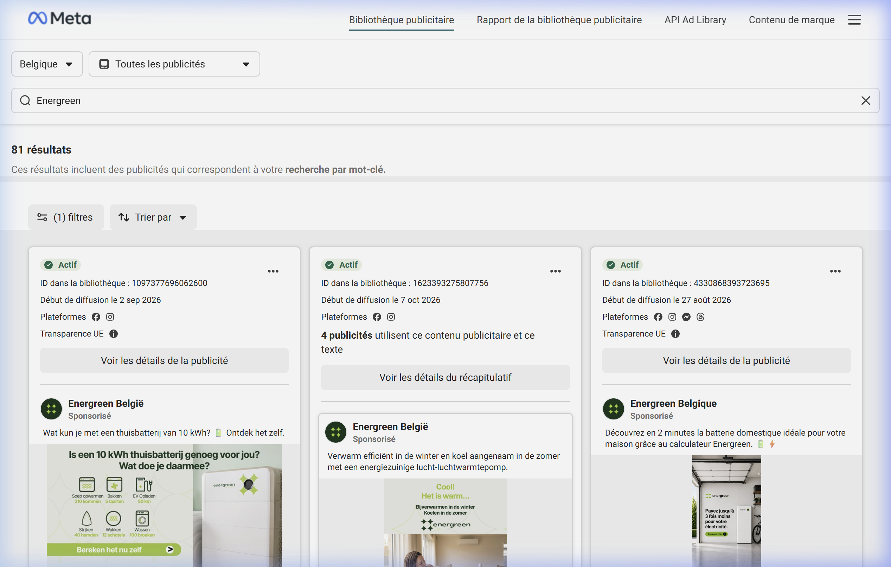
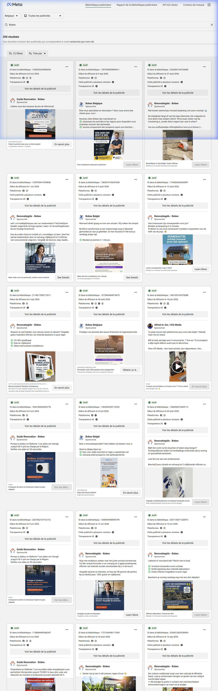

# Audit Stratégique Meta Ads Library — Concurrence Solaire Wallonie & Belgique

*Date de l'audit : 23 Octobre 2026*  
*Source : Meta Ads Library (Belgique, statut « Actif », catégorie « Toutes les publicités »)*  
*Volume global observé : 530+ annonces actives sur la thématique photovoltaïque & transition énergétique résidentielle.*

---

## 1. Vue d'Ensemble du Marché Publicitaire Solaire en Belgique

L'analyse de la bibliothèque publicitaire Meta met en évidence un marché belge scindé en trois catégories d'acteurs :

1. **Les comparateurs de masse & agences de Lead-Gen** (*Bobex, Guide Rénovation, plateformes affiliées*) :
   - Volume massif (plus de 200 déclinaisons publicitaires actives).
   - Stratégie d'appel agressive axée sur des prix planchers ou des formulaires de subventions.
2. **Les installateurs historiques & acteurs intégrés** (*Energreen, Otovo, Luminus / Dauvister*) :
   - Volume soutenu (81 annonces actives pour Energreen Belgique).
   - Transition marquée vers l'écosystème complet : batterie domestique, pompe à chaleur, domotique et gestion du talon de consommation.
3. **Les acteurs techniques & vulgarisation** (*Wattuneed, Hello Watt*) :
   - Formats vidéo éducatifs, déconstruction des objections du marché, kits hybrides et simulateurs d'autonomie.

---

## 2. Décryptage des 3 Meilleurs Concepts Publicitaires Concurrents (> 60-90 jours)

Une publicité active depuis plus de 60 à 90 jours sur Meta indique un seuil de rentabilité prouvé (l'annonceur ne continue pas à dépenser quotidiennement sur un créatif non rentable).

### Concept 1 : La « Tangibilité Électrique » & Simulateur de Batterie (Energreen Belgique)

* **Date de diffusion** : Active depuis le 27 août 2026 (> 60 jours de diffusion continue).
* **Format** : Image statique haut de gamme (garage épuré avec batterie murale design) et infographie.
* **Hook d'accroche** :
  > *« Wat kun je met een thuisbatterij van 10 kWh ? Ontdek het zelf. »* / *« Découvrez en 2 minutes la batterie domestique idéale pour votre maison grâce au calculateur. »*
* **Mécanique psychologique** :
  - **Traduction concrète de l'énergie** : Au lieu de parler de concepts abstraits comme le `kWh`, le visuel liste ce que permet une batterie 10 kWh au quotidien (100 pantalons lavés, 5 tartes cuites au four, 50 km de recharge véhicule électrique, 40 chemises repassées).
  - **Promesse chiffrée** : *« Payez jusqu'à 3 fois moins pour votre électricité. »*
  - **CTA** : *« En savoir plus »* redirigeant vers un calculateur interactif personnalisé en 2 minutes.

---

### Concept 2 : Le « Package Prix Choc » & Urgence Réglementaire (Bobex / Guide Rénovation)

* **Date de diffusion** : Multiples variantes en ligne depuis juillet et août 2026.
* **Format** : Carte visuelle directe avec badge promotionnel, puces vertes (✔️) et photo de toiture.
* **Hook d'accroche** :
  > *« Libérez-vous des hausses de prix de l'électricité — Offre Spéciale 2.999 € »*  
  > *« Propriétaire en Wallonie ? Les aides ont changé. Jusqu'à 50% pris en charge par la Région ou prêt à taux zéro jusqu'à 75.000 €. Vérifiez vos aides en 30 secondes. »*
* **Mécanique psychologique** :
  - **Ancrage prix ultra-bas** : `2.999 €` pour 10 panneaux + onduleur avec garantie 25 ans. Même si ce prix exclut souvent la complexité réelle de l'installation, il génère un taux de clic (CTR) massif.
  - **FOMO Réglementaire** : Exploitation des changements d'aides et primes de la Région wallonne pour créer une urgence administrative.
  - **CTA** : *« En savoir plus »* / *« Obtenir un devis »* vers formulaire instantané Lead Ads ou formulaire court en 3 étapes.

---

### Concept 3 : L'Interview d'Expert « Zéro Bullshit » (Wattuneed)
* **Date de diffusion** : Active depuis début juillet 2026.
* **Format** : Vidéo podcast / face caméra (UGC d'ingénieur/technicien avec Brian de L'ArchiPelle).
* **Hook d'accroche** :
  > *« Autonomie solaire en 2026 : ce qui a changé. Coût des batteries divisé par ~5 depuis 2021, onduleurs hybrides plus malins, et LA question : combien stocker pour passer la nuit ? »*
* **Mécanique psychologique** :
  - **Autorité technique** : Pas de discours commercial mielleux, mais une démonstration technique par la preuve.
  - **Résolution d'objection** : Montre que la technologie a mûri et que le stockage n'est plus un luxe inaccessible.
  - **CTA** : *« Voir la vidéo / Découvrir les solutions »*.

---

## 3. Analyse des Angles Saturés & Faiblesses Concurrentes

Voici ce que 80 % du marché diffuse actuellement et qu'Aegis Solaire doit impérativement **éviter** :

| Angle Saturé | Message Typique Concurrent | Faiblesse Majeure & Rejet du Client |
| :--- | :--- | :--- |
| **Le Prix d'Appel Illusoire** | « Votre kit 10 panneaux pour 2.999 € » | Déception brutale lors du devis réel (raccordement, renfort de toiture, compteur, taxes non inclus). Crée de la méfiance. |
| **Le Comparateur "5 Devis Gratuits"** | « Recevez jusqu'à 5 devis d'installateurs locaux » | **Harcèlement téléphonique garanti.** Le prospect est assailli par 4 ou 5 démarcheurs commerciaux dans les 2 heures. |
| **Le Flou Réglementaire Wallon** | Promesses génériques ignorant le Tarif Prosumer | Le particulier craint de payer le tarif prosumer sans savoir si ses panneaux sont encore rentables sans compensation annuelle. |
| **Le Modèle de Lead Revendu à la Découpe** | Dévoilé par les concurrents eux-mêmes (pubs B2B ICD Media) | Le client sait désormais que ses données personnelles sont vendues à des courtiers tiers. |

---

## 4. Les « White Spaces » : Comment Aegis Solaire Doit Dominer

Aegis Solaire possède un positionnement unique qui répond exactement aux points de douleur négligés par Bobex et Energreen :

* **Opportunité 1 : Le Tiers de Confiance Impartial (Anti-Démarchage)**  
  *« Nous ne vendons pas de panneaux. Nous auditons votre toiture pour que vous ne signiez pas n'importe quoi. »*  
  Zéro harcèlement téléphonique, coordonnées protégées. Transmission du dossier à **un seul** artisan local labellisé RESCERT soigneusement sélectionné.

* **Opportunité 2 : La Démystification Mathématique du Tarif Prosumer**  
  *« Le compteur qui tourne à l'envers est terminé en Wallonie. Voici le calcul exact pour rentabiliser votre toiture en 2026. »*  
  Utiliser les chiffres réels de la CWaPE, expliquer l'autoconsommation (30 % sans batterie vs 70 % avec batterie) et le dimensionnement optimal.

* **Opportunité 3 : La Réassurance « Swiss Editorial & Trust »**  
  Sortir des visuels criards jaunes/rouges de Bobex. Utiliser la palette institutionnelle (Ardoise, Pierre Chaude, Cuivre Solaire), typographie soignée (`font-mono` sur les chiffres d'économies) et clarté chirurgicale.
