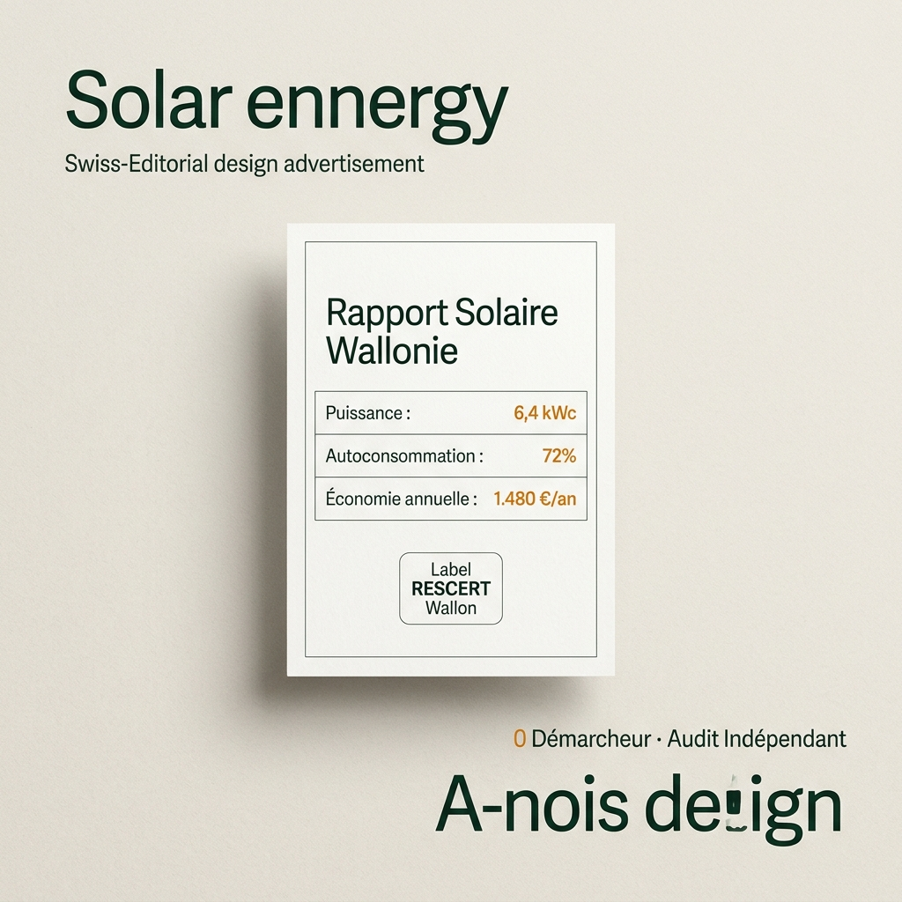
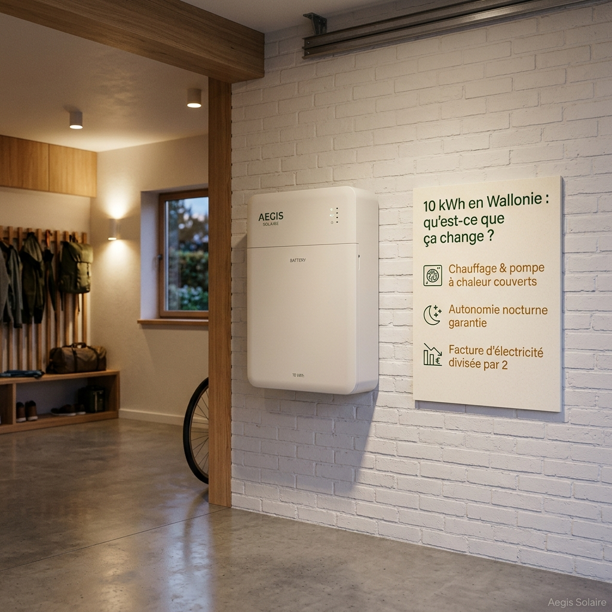

# Pack Publicitaire Meta Ads Haute Performance — Aegis Solaire Wallonie

*Basé sur les compétences `meta-ads-copywriter` et `meta-ads-creative-framework` ainsi que l'audit de la Meta Ads Library Belgique 2026.*  
*Marché ciblé : Wallonie (Brabant wallon, Liège, Namur, Hainaut, Luxembourg).*

---

## Sommaire Exécutif & Équation de Valeur (Alex Hormozi)

Pour battre les campagnes génériques des comparateurs (Bobex, TrustUp) et des installateurs traditionnels (Energreen, Otovo), chaque publicité capitalise sur l'équation de valeur maximale :

$$\text{Valeur Perçue} = \frac{\text{Résultat Rêvé} \times \text{Probabilité Perçue de Réussite}}{\text{Délai d'Obtention} \times \text{Effort \& Sacrifice}}$$

* **Résultat Rêvé (Dream Outcome)** : Réduction drastique de la facture d'électricité (`-60%` à `-70%`), neutralisation de la hausse du tarif prosumer, indépendance énergétique sur 25 ans.
* **Probabilité Perçue (Perceived Likelihood)** : Tiers de confiance neutre (aucun panneau à vendre), sélection drastique d'artisans certifiés **RESCERT**, conformité technique garantie.
* **Délai d'Obtention (Time Delay)** : Simulation ultra-rapide en `45 s`, rapport d'ingénierie instantané, devis ferme sous `48 h`.
* **Effort & Sacrifice (Effort & Sacrifice)** : **Zéro harcèlement téléphonique** (fin des 5 démarcheurs en simultané), 100 % gratuit, sans engagement.

---

## Direction Artistique : "Swiss Editorial & Trust"

Les créations publicitaires rompent formellement avec les codes discount du secteur (bannières fluo, badges "PROMO", promesses mensongères de gratuité).

*Format A : La Carte d'Audit Technique (Fond pierre minérale, typographie institutionnelle vert forêt, données chiffrées en `font-mono tabular-nums`).*

*Format B : La Tangibilité Électrique (Mise en situation réelle dans une maison wallonne, valorisation de l'autoconsommation).*

---

## Pack Publicitaire #1 : La Rentabilité Solaire Réelle 2026 (Fin du Compteur qui Tourne à l'Envers)
*Angle déconstruisant le mythe selon lequel les panneaux photovoltaïques ne sont plus rentables depuis la fin de la compensation intégrale. 100 % orienté vers de nouvelles installations complètes de panneaux solaires en toiture.*

### 1. Copies Publicitaires Meta (Facebook / Instagram)

* **Primary Text Court (Mobile First — 112 caractères)** :
  > Les panneaux solaires sont-ils encore rentables en Wallonie ? Oui, jusqu'à 70 % d'économies réseau. Testez en 45 s.

* **Primary Text Moyen (Accroche + Chiffres concrets — 275 caractères)** :
  > Beaucoup pensent que la fin du compteur qui tourne à l'envers a tué le solaire en Wallonie. C'est faux : avec la flambée des tarifs réseau ORES/RESA (0,35 €/kWh), 12 panneaux bien dimensionnés vous font économiser jusqu'à 1 450 € par an. Amortissement : 6 à 8 ans. Calculez votre rentabilité en 45 s.

* **Primary Text Long (Éducation & Tiers de Confiance — 520 caractères)** :
  > « Est-ce que ça vaut encore le coup d'installer des panneaux solaires en Wallonie en 2026 ? »
  >
  > C'est la question que tous les propriétaires se posent depuis la fin de la compensation intégrale.
  >
  > La réalité des chiffres :
  > 1. Le coût du matériel photovoltaïque a chuté en 3 ans.
  > 2. L'électricité réseau coûte toujours plus de 0,35 €/kWh.
  > 3. Chaque kWh solaire produit et consommé sur place est un kWh que vous n'achetez pas au fournisseur.
  >
  > Résultat : pour une toiture bien orientée, l'économie moyenne atteint 1 450 € par an avec un retour sur investissement en 6 à 8 ans.
  >
  > En 45 secondes, notre simulateur neutre calcule le potentiel de votre toiture et transmet votre dossier à 1 seul artisan agréé RESCERT local. 0 démarchage.

* **Headline (Titre d'annonce)** :
  > Panneaux solaires 2026 : calculez vos économies réelles

* **Description (Réassurance)** :
  > Simulation gratuite en 45 s · 1 artisan RESCERT dédié

* **Bouton CTA Meta** :
  > *Obtenir un devis*

---

### 2. Scripts Vidéo Minutés (UGC / Voix-off & Face Caméra)

#### Script 30 Secondes (≈ 74 mots)
> *(Plan 0-4s : Face caméra devant une maison ou plan sur un toit wallon sous le soleil).*  
> **Créateur** : « Tout le monde vous dit que les panneaux solaires ne valent plus le coup en Wallonie ? C'est faux.  
> *(Plan 4-15s : Infographie simple montrant le prix du kWh réseau vs autoproduction).*  
> Avec l'électricité réseau à plus de 0,35 € le kWh, une installation bien dimensionnée s'amortit en 6 à 8 ans et divise votre facture annuelle par deux.  
> *(Plan 15-30s : Démonstration sur smartphone du simulateur).*  
> Calculez la rentabilité exacte de votre toiture en 45 secondes sur Aegis Solaire. Cliquez ci-dessous. »

#### Script 60 Secondes (≈ 148 mots)
> *(Plan 0-6s : Face caméra en extérieur devant une maison unifamiliale).*  
> **Créateur** : « Est-ce que ça vaut encore le coup de poser des panneaux solaires en Wallonie depuis la fin du compteur qui tourne à l'envers ?  
> *(Plan 6-25s : Tableau blanc ou écran montrant le calcul).*  
> Avant 2024, on surdimensionnait les installations sans réfléchir. Aujourd'hui, la règle a changé : on dimensionne précisément selon votre consommation réelle de la journée.  
> *(Plan 25-45s : Mise en avant des chiffres concrets).*  
> Pour une maison 4 façades type avec 12 à 14 panneaux, vous autoconsommez votre propre énergie au lieu de la payer 0,35 €/kWh sur le réseau. L'économie nette moyenne atteint 1 450 € par an, et votre toiture est rentabilisée en 6 à 8 ans.  
> *(Plan 45-60s : Tiers de confiance).*  
> Pour connaître votre rentabilité exacte sans subir le harcèlement de 5 démarcheurs commerciaux, faites le test neutre en 45 secondes sur Aegis Solaire. Votre dossier est confié à un seul artisan certifié RESCERT de votre commune. Cliquez sur le lien. »

#### Script 90 Secondes (≈ 210 mots)
> *(Plan 0-10s : Face caméra calme, ton posé d'ingénieur).*  
> **Expert** : « Depuis le 1er janvier 2024, le marché solaire wallon a totalement changé. Si un installateur vous parle encore comme à l'époque de l'ancien compteur, méfiez-vous. Voici la vérité économique sur les panneaux solaires en 2026.  
> *(Plan 10-35s : Schéma visuel propre sur tablette).*  
> En Wallonie, les nouveaux compteurs mesurent séparément ce que vous injectez et ce que vous prélevez. Injecter votre surplus sur le réseau ne rapporte que quelques centimes. En revanche, chaque kWh solaire consommé directement à la maison vous fait économiser le prix plein du réseau, soit près de 35 centimes par kWh.  
> *(Plan 35-65s : Dimensionnement optimal).*  
> Le secret n'est donc plus de couvrir tout le toit pour revendre, mais de poser le nombre exact de panneaux adapté au talon de consommation de votre foyer (généralement 10 à 14 panneaux pour une maison familiale). À ce format, le projet s'amortit en 6 à 8 ans et vous procure 25 ans d'électricité à coût quasi nul.  
> *(Plan 65-90s : Appel à l'action).*  
> Aegis Solaire a développé un simulateur d'ingénierie neutre qui calcule votre production en 45 secondes et vous met en relation avec un seul artisan certifié RESCERT de votre région. 0 démarchage, 100 % gratuit. Cliquez ci-dessous pour tester votre toiture. »

---

## Pack Publicitaire #2 : La Charte Anti-Arnaque & Zéro Harcèlement
*Angle capitalisant sur le rejet massif des comparateurs de type Bobex qui revendent le lead à 5 démarcheurs simultanés.*

### 1. Copies Publicitaires Meta (Facebook / Instagram)

* **Primary Text Court (Mobile First — 118 caractères)** :
  > Besoin d'un devis solaire sans recevoir 5 appels de démarcheurs ? 1 audit neutre. 1 seul artisan RESCERT local. 0 pression.

* **Primary Text Moyen (Accroche + Douleur + Solution — 242 caractères)** :
  > Vous avez déjà demandé un devis solaire pour finir harcelé au téléphone par 4 entreprises différentes ?  
  > 
  > Aegis Solaire met fin à cette pratique : nous auditons votre toiture en toute neutralité et ne transmettons votre dossier qu'à 1 seul installateur certifié RESCERT de votre province.

* **Primary Text Long (Autorité & Tiers de Confiance — 388 caractères)** :
  > Les formulaires « 5 devis gratuits » cachent une réalité dérangeante : vos coordonnées sont revendues aux enchères à des démarcheurs commerciaux qui vous appellent en boucle.  
  > 
  > Chez Aegis Solaire, nous avons fait le choix inverse :  
  > 1. Vous réalisez votre simulation en 45 s avec notre outil d'ingénierie neutre.  
  > 2. Vos données restent strictement confidentielles.  
  > 3. Votre projet n'est confié qu'à un artisan de confiance, audité et titulaire du label wallon RESCERT.  
  > 
  > Obtenez une estimation technique rigoureuse, sans pression commerciale.

* **Headline (Titre d'annonce)** :
  > 1 Toiture. 1 Audit. 0 Démarcheur agressif.

* **Description (Réassurance)** :
  > Label RESCERT Wallon certifié

* **Bouton CTA Meta** :
  > *Obtenir un devis*

---

### 2. Scripts Vidéo Minutés (Format UGC Authentique / Démonstration)

#### Script 30 Secondes (≈ 76 mots)
> *(Plan 0-4s : Le créateur regarde son téléphone qui sonne en chaîne, l'air agacé).*  
> **Créateur** : « C'est ce qui arrive quand vous demandez des devis sur un comparateur classique : 5 entreprises qui vous appellent à tour de rôle pendant une semaine.  
> *(Plan 4-15s : Il montre l'écran calme d'Aegis Solaire sur son ordinateur portable).*  
> Pour mon installation solaire en Wallonie, je suis passé par Aegis Solaire.  
> *(Plan 15-30s : Il montre le rapport de simulation clair et net).*  
> Zéro harcèlement. Un audit technique neutre et un seul installateur local certifié RESCERT m'a contacté avec une offre sur-mesure. Testez leur simulateur gratuitement. »

#### Script 60 Secondes (≈ 152 mots)
> *(Plan 0-6s : Face caméra dans son jardin ou devant sa maison).*  
> **Créateur** : « Si vous envisagez de poser des panneaux solaires en Belgique, voici la pire erreur à commettre.  
> *(Plan 6-25s : Ton de confidence direct).*  
> Cliquer sur une annonce qui promet "5 devis gratuits en 30 secondes". Ce que ces sites ne vous disent pas, c'est que votre numéro est revendu instantanément à des plateformes d'appels. Vous vous retrouvez avec des commerciaux agressifs qui veulent vous faire signer le jour même sur un coin de table.  
> *(Plan 25-45s : Navigation fluide sur le simulateur Aegis Solaire).*  
> À la place, utilisez Aegis Solaire. C'est une plateforme d'ingénierie indépendante. Vous renseignez votre commune, votre type de toit et votre facture. En 45 secondes, l'outil calcule la puissance exacte nécessaire pour annuler votre facture d'électricité.  
> *(Plan 45-60s : Conclusion sereine).*  
> Et surtout : votre dossier n'est transmis qu'à un seul installateur certifié RESCERT près de chez vous. Pas de vente forcée, pas d'appels incessants. Cliquez sur le lien pour démarrer. »

---

## Pack Publicitaire #3 : La Vérité Mathématique sur le Tarif Prosumer Wallon
*Angle éducatif inspiré de Wattuneed et Hello Watt : répondre à l'inquiétude n°1 des propriétaires wallons.*

### 1. Copies Publicitaires Meta (Facebook / Instagram)

* **Primary Text Court (Mobile First — 122 caractères)** :
  > Le photovoltaïque est-il encore rentable en Wallonie sans compteur qui tourne à l'envers ? La réponse chiffrée en 45 s.

* **Primary Text Moyen (Démystification & Clarté — 244 caractères)** :
  > « Avec le tarif prosumer, les panneaux ne valent plus le coup. » Faux.  
  > 
  > En réalité, une installation correctement calibrée s'amortit aujourd'hui en 5 à 7 ans grâce à la baisse du prix du matériel. Faites le calcul précis pour votre commune en 45 secondes.

* **Primary Text Long (Argumentaire Technique & Rigoureux — 392 caractères)** :
  > Beaucoup de propriétaires wallons hésitent encore à cause de la fin du compteur qui tourne à l'envers et du tarif prosumer.  
  > 
  > Faisons le calcul :  
  > En 2026, le coût du matériel photovoltaïque a baissé de plus de 40% par rapport aux pics historiques. Même en payant la contribution réseau, chaque kWh que vous consommez directement sur votre toit vous fait économiser 0,35 € sur votre facture fournisseur.  
  > 
  > Le secret n'est pas de surdimensionner son toit, mais d'ajuster la puissance à son profil de vie.  
  > 
  > Calculez votre retour sur investissement réel grâce à notre simulateur certifié pour la Région wallonne.

* **Headline (Titre d'annonce)** :
  > Panneaux solaires en 2026 : Rentable chez vous ?

* **Description (Réassurance)** :
  > Calcul précis normes CWaPE

* **Bouton CTA Meta** :
  > *En savoir plus*

---

### 2. Script Vidéo Minuté (Format VSL Pédagogique 60 Secondes)

#### Script 60 Secondes (≈ 158 mots)
> *(Plan 0-5s : Plan net sur un tableau électrique ou facture d'électricité wallonne avec mention du tarif prosumer).*  
> **Voix / Expert** : « Est-ce que le solaire est devenu un piège financier en Wallonie ? On entend tout et son contraire depuis les réformes de la CWaPE.  
> *(Plan 5-25s : Infographie animée style Swiss Editorial montrant les courbes de production et de consommation).*  
> La vérité est mathématique : l'époque où l'on installait 25 panneaux pour revendre bêtement à perte est terminée. Aujourd'hui, la rentabilité repose à 100% sur l'autoconsommation.  
> *(Plan 25-45s : Plan sur l'écran du simulateur avec résultats chiffrés).*  
> En adaptant votre installation à vos besoins réels et en évitant les devis gonflés, votre installation reste amortie en moins de 6 ans, avec un rendement net supérieur à n'importe quel livret d'épargne.  
> *(Plan 45-60s : Écran de fin épuré avec l'URL et logo Aegis Solaire).*  
> Ne vous fiez pas aux promesses des démarcheurs. Obtenez un audit financier neutre et sans engagement en 45 secondes sur Aegis Solaire. Cliquez sur le lien pour commencer. »

---

## Paramètres de Campagne & Événements Pixel

* **Objectif** : Prospects / Leads vers `https://aegis-solaire.be/devis-panneaux-solaires`.
* **Ciblage géographique** : Wallonie (Brabant wallon, Liège, Namur, Hainaut, Luxembourg).
* **Cible socio-démographique** : 30-65 ans, propriétaires de maisons 2, 3 ou 4 façades.
* **Pixel Meta** : Événement `Lead` validé sur soumission du formulaire complet.
* **UTMs recommandés** :
  `?utm_source=facebook&utm_medium=paid&utm_campaign=wallonie_solaire_2026&utm_content={{ad.name}}`
