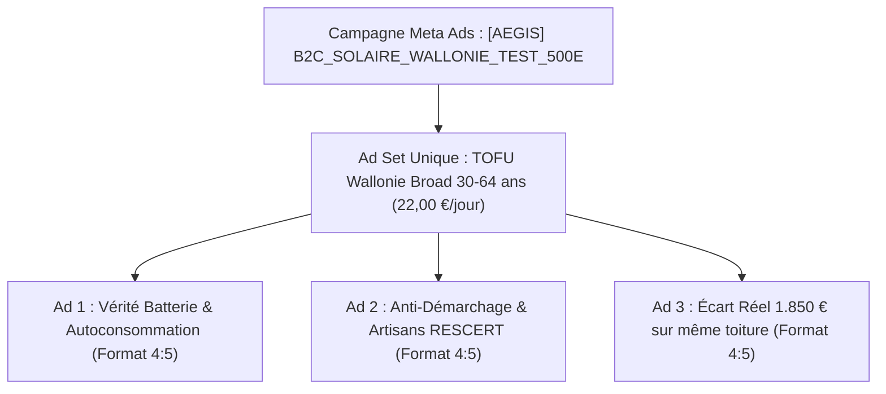

# Plan de Lancement & Configuration Meta Ads (Budget MAX 500 €)
**Aegis Solaire — Acquisition Résidentielle Wallonie (Lead Generation)**

---

## 1. Synthèse Exécutive & Objectifs Chiffrés

| Indicateur | Valeur Cible | Remarque / Benchmark Wallon |
|---|---|---|
| **Budget Total Strict** | **500,00 €** | Aucun dépassement possible |
| **Durée de Campagne** | **22 à 25 jours** | Rythme chirurgical de 20 € à 22 € / jour |
| **Format Publicitaire** | **100 % Statiques & Carrousel** | Aucun tournage vidéo requis |
| **Coût par Clic Cible (CPC)** | **0,75 € – 1,15 €** | Benchmarking marché solaire wallon |
| **Taux de Conversion Landing (CVR)** | **8,5 % – 13 %** | Optimisé sur `/devis-panneaux-solaires` |
| **Coût par Lead Cible (CPL)** | **20,00 € – 27,00 €** | Lead qualifié B2C propriétaire de maison |
| **Volume de Leads Attendus** | **18 à 25 leads** | Coordonnées complètes + adresse toiture validée |
| **Valeur Revente B2B Installateur** | **50 € – 65 € / lead** | Grille tarifaire Aegis Marketplace |
| **Revenu Brut Estimé** | **900 € – 1 625 €** | **ROI attendu : 180 % à 325 %** |

---

## 2. Architecture du Compte & Pacing Budgétaire

### Pourquoi 1 Seul Ad Set Broad (22 €/jour) et PAS de Retargeting Séparé ?
1. **Éviter la dilution sur petit budget** : Avec 22 €/jour sur 500 € au total, créer un Ad Set de retargeting à 4 €/j est une erreur d'échelle. À J+8, après refus de consentement RGPD (40 %) et déperditions de clics, le bassin de visiteurs uniques n'atteindra que ~55 personnes. Y diffuser 4 €/jour générerait une fréquence toxique de 4 à 6 vues par jour par utilisateur, menant à l'agacement et à la fatigue créative.
2. **Retargeting natif Advantage+** : L'algorithme Meta en acquisition froide réexpose automatiquement les annonces aux utilisateurs ayant interagi sans convertir, sans nécessiter de compartiment budgétaire dédié.



### Répartition & Pacing du Budget (500 €)
* **Ad Set Unique (TOFU Broad Wallonie)** : **22,00 € / jour**
* **Durée de diffusion** : 22 à 23 jours (épuisement maîtrisé des 500 €).
* **Créatifs actifs au lancement** : **3 annonces statiques au format 4:5 vertical** (Ad 1, Ad 2, Ad 3). Le carrousel est conservé en réserve pour relancer la diffusion si l'un des angles s'essouffle.

---

## 3. Paramétrage Précis dans Meta Ads Manager

### Niveau Campagne
- **Nom de Campagne** : `[AEGIS] B2C_SOLAIRE_WALLONIE_TEST_500E`
- **Catégorie Spéciale** : **Aucune** (Le photovoltaïque ne relève ni du crédit, ni de l'emploi, ni du logement locatif).
- **Objectif de Campagne** : **PROSPECTS (Leads)**
- **Budget de campagne Advantage** : **Désactivé** (géré au niveau Ad Set).

### Niveau Ad Set Unique
- **Nom de l'Ensemble** : `TOFU_Wallonie_Broad_Proprietaires_30-64`
- **Lieu de Conversion** : **Site Web** (`https://aegissolaire.com/devis-panneaux-solaires`)
- **Pixel Meta** : Sélectionner le Pixel Aegis Solaire (`NEXT_PUBLIC_META_PIXEL_ID`)
- **Événement de Conversion** : **Lead**
- **Budget Quotidien** : **22,00 € / jour**
- **Stratégie d'Enchère** : **Volume le plus élevé** (Lowest Cost, aucun plafond Cost Cap).
- **Lieux Géographiques (Inclusions strictes)** :
  - Belgique > Province de Liège
  - Belgique > Province de Namur
  - Belgique > Province du Brabant Wallon
  - Belgique > Province de Hainaut
  - Belgique > Province de Luxembourg
  - *Option géographique* : « Personnes vivant à cet endroit » (désactiver l'élargissement Advantage+ pour ne pas déborder en Flandre ou France).
- **Âge** : **30 – 64 ans** (exclusion stricte des 65+ qui cliquent par curiosité mais ne rentabilisent pas un projet solaire).
- **Langue** : **Français**
- **Ciblage Avancé Advantage+** : Activé sans restrictions d'intérêts. Le filtrage des propriétaires s'opère organiquement par les hooks visuels et le simulateur.
- **Placements** : **Placements Advantage+** (Recommandé par Meta).
- **Exclusion d'Audience** : Événement Pixel `Lead` sur 180 jours (ne jamais repayer pour un prospect déjà acquis).

---

## 4. Système de Tracking, Déduplication Pixel & CAPI

Le système technique a été directement intégré et validé dans le code source du projet Aegis Solaire.

### 1. Déduplication Parfaite Browser/Server via `eventID`
Pour garantir un **Event Match Quality (EMQ) supérieur à 8,5/10** et éviter que Meta ne compte les leads en double :
- **Côté Serveur (`lib/meta-capi.ts`)** : L'API envoie l'événement `Lead` sur Graph API **v22.0** avec `event_id = inserted.id`, `event_source_url = "https://www.aegissolaire.com/devis-panneaux-solaires"`, accompagné du hachage SHA-256 de l'email, du téléphone normalisé (+32), de l'IP et de l'User-Agent.
- **Côté Navigateur (`components/analytics/ad-tracking.tsx`)** : La fonction client transmet :
  ```javascript
  window.fbq("track", "Lead", eventData, { eventID: leadId })
  ```
- Meta fusionne automatiquement le signal navigateur et le signal serveur grâce à cet `eventID` unique.

### 2. Bandeau de Consentement & Mode Consent Revoke/Grant
- Un bandeau léger et conforme APD/ePrivacy (`components/analytics/cookie-consent-banner.tsx`) conditionne le Pixel.
- Par défaut, si l'internaute n'a pas encore cliqué sur "Accepter", le Pixel est initialisé en mode `fbq('consent', 'revoke')`.
- Dès acceptation, le mode `grant` s'active et le choix est mémorisé 6 mois dans le cookie `aegis_cookie_consent`.

### 3. Modèle d'URL Standardisé pour vos Annonces
À coller dans le champ **Paramètres d'URL** de chaque annonce Meta :
```text
utm_source=meta&utm_medium=cpc&utm_campaign={{campaign.name}}&utm_content={{ad.name}}&utm_term={{adset.name}}
```
**URL finale de destination** :
```text
https://aegissolaire.com/devis-panneaux-solaires
```

---

## 5. Pack Créatif Complet — Formats Statiques & Carrousel

Tous les fichiers créatifs finaux ont été compilés en haute définition (PNG) via Playwright et sont prêts à être téléversés depuis le dossier :  
📂 **`campagnes-meta/creatives-final/`**

---

### Annonce 1 : "Rentabilité Panneaux Solaires 2026"
*Fichiers : `ad_angle1_rentabilite_1080x1350.png` (Format 4:5 vertical) et `ad_angle1_rentabilite_1080x1080.png` (1:1 carré)*

#### Textes Publicitaires (Copies Meta)
- **Primary Text Court (Mobile sans 'Voir plus' — 112 car.)** :  
  Les panneaux solaires sont-ils encore rentables en Wallonie ? Oui, jusqu'à 70 % d'économies réseau. Testez en 45 s.
- **Primary Text Long (415 car.)** :  
  « Le photovoltaïque n'est plus rentable depuis la fin de l'ancien compteur » : c'est mathématiquement faux.  
  
  Avec un dimensionnement adapté à votre toiture, vos panneaux solaires effacent jusqu'à 70 % de vos achats réseau au tarif fort (0,35 €/kWh). Pour une maison type (12 panneaux · 5,2 kWc), l'économie nette moyenne atteint 1 450 €/an avec un amortissement complet en 6 à 8 ans.  
  
  Avant de signer un devis, calculez vos économies réelles en 45 secondes. 1 seul artisan RESCERT dédié, 0 démarcheur.
- **Headline (Titre — max 40 car.)** : `Panneaux solaires 2026 : calculez vos économies`
- **Description (max 30 car.)** : `100 % gratuit · 1 artisan RESCERT`
- **Bouton d'Action (CTA)** : `Obtenir un devis`

---

### Annonce 2 : "Anti-Démarchage Agressif & Artisans Agréés RESCERT"
*Fichiers : `ad_angle2_rescert_1080x1350.png` (Format 4:5) et `ad_angle2_rescert_1080x1080.png` (1:1)*

#### Textes Publicitaires
- **Primary Text Court (112 car.)** :  
  Marre des commerciaux solaires insistants ? Comparez 3 installateurs certifiés RESCERT près de chez vous, 0 pression.
- **Primary Text Long (382 car.)** :  
  Vous avez déjà reçu ces appels de démarcheurs promettant des « panneaux solaires gratuits par la Région » ? C'est illégal et mensonger.  
  
  Pour réussir votre transition en Wallonie : exigez le label officiel RESCERT et comparez 3 artisans locaux sur un pied d'égalité.  
  
  Aegis protège vos coordonnées et sélectionne les meilleurs professionnels de votre province. Devis sous 48 h, 100 % transparent.
- **Headline** : `0 démarchage agressif. Comparez.`
- **Description** : `Sans engagement ni harcèlement`
- **Bouton d'Action (CTA)** : `Obtenir un devis`

---

### Annonce 3 : "Écart de Devis Réel (1 850 € sur une même toiture)"
*Fichiers : `ad_angle3_ecart1850_1080x1350.png` (Format 4:5) et `ad_angle3_ecart1850_1080x1080.png` (1:1)*

#### Textes Publicitaires
- **Primary Text Court (116 car.)** :  
  Jusqu'à 1 850 € d'écart constaté sur une même installation solaire en Wallonie. Comparez 3 devis avant de vous engager.
- **Primary Text Long (365 car.)** :  
  Combien doit réellement coûter une installation photovoltaïque de qualité en Wallonie en 2026 ?  
  
  Sur les chantiers audités par notre réseau, nous constatons jusqu'à 1 850 € de différence pour des panneaux et onduleurs équivalents.  
  
  Ne payez pas la marge excessive d'intermédiaires. Obtenez 3 propositions chiffrées d'installateurs agréés de votre commune en 45 secondes. 100 % gratuit.
- **Headline** : `1 850 € d'écart sur le même devis`
- **Description** : `Simulation gratuite en 45 secondes`
- **Bouton d'Action (CTA)** : `Obtenir un devis`

---

### Annonce 4 : Carrousel 3 Cartes "Le Vrai / Faux du Solaire Wallon"
*Fichiers : `carrousel_carte1_1080x1080.png`, `carrousel_carte2_1080x1080.png`, `carrousel_carte3_1080x1080.png`*

- **Primary Text Global** :  
  Tarif prosumer, fin du compteur qui tourne à l'envers, promesses de gratuité... Décryptage de 3 mythes solaires en Wallonie en 2026. Glissez pour découvrir la réalité chiffrée.
- **Titres de Cartes (Headlines par slide)** :
  - Carte 1 : `Mythe #1 : Rentabilité avec batterie`
  - Carte 2 : `Mythe #2 : Panneaux gratuits ? Faux.`
  - Carte 3 : `Conseil #3 : Économisez jusqu'à 1.850 €`
- **URL de Destination de chaque Carte** :  
  `https://aegissolaire.com/devis-panneaux-solaires?utm_source=meta&utm_medium=cpc&utm_campaign={{campaign.name}}&utm_content=carrousel_vrai_faux`

---

## 6. Protocole de Suivi & Règles de Pilotage Budgétaire (KILL / SCALE)

Avec 500 €, chaque euro compte. Pour éviter les coupures hâtives fondées sur du bruit statistique (loi binomiale sur petits échantillons) :

### Protocole Décisionnel par Créatif
1. **Seuil Minimal d'Échantillonnage (1 500 impressions)** :
   - Ne couper **aucune** annonce avant qu'elle n'ait franchi **1 500 impressions**. Sur 500 impressions, la variance statistique est trop forte (15 % de chances qu'une excellente pub à 1,2 % de CTR fasse moins de 4 clics par simple hasard).
2. **KILL Niveau 1 (~25 € dépensés / annonce) — Ne pas se fier uniquement à Meta Ads Manager** :
   - *Piège opérationnel* : L'événement `InitiateCheckout` (Step 5 -> 6) est masqué côté Pixel pour ~40 % des visiteurs qui refusent le bandeau cookies.
   - *Vérité terrain* : Ouvrir la table interne `funnel_step_events` dans Supabase filtrée par `utm_content`.
   - *Règle d'arrêt* : Si une annonce franchit **25 € dépensés** avec un **CTR lien < 0,8 %** ET un effondrement du taux d'accès à l'étape 5 dans la table de télémétrie, mise en **PAUSE immédiate**.
3. **KILL Niveau 2 (Défaut de Conversion Finale — ~50 € dépensés)** :
   - Si une annonce atteint **50 € dépensés** (environ 2x le CPL cible net) avec **0 Lead généré** (Pixel + CAPI dédupliqué) : coupure définitive.
4. **Règle KEEP & Consolidation (J+7 à J+10)** :
   - Toute annonce générant des leads à un **CPL net < 25 €** reste active.
   - Si un angle domine nettement (ex: Angle 1 Batterie), laisser l'algorithme concentrer 80 % du budget quotidien dessus.
   - Garder le Carrousel en réserve si un renouvellement créatif s'avère nécessaire vers J+14.

---

## 7. Checklist "Go / No-Go" Avant Lancement

- [x] **Architecture Mono Ad Set** : 1 ensemble unique TOFU Broad Wallonie à 22,00 €/j (30–64 ans).
- [x] **Tracking Pixel client** configuré avec transmission de `eventID` pour déduplication.
- [x] **API Meta Conversions (CAPI)** activée en Graph API v22+ avec `user_data` complet (em, ph normalisé E.164, fn, ln, zp, country="be", fbp, fbc formaté `fb.1...`) pour viser un EMQ $\ge$ 8,8/10.
- [x] **Table de télémétrie d'entonnoir interne** : `funnel_step_events` déployée dans Supabase avec attribution `utm_content` pour auditer 100 % des visiteurs sans dépendance aux cookies tiers.
- [x] **Bandeau de consentement cookies** conforme APD/ePrivacy déployé avec bascule `grant/revoke`.
- [x] **Capture des UTMs & fbclid** opérationnelle sur `/devis-panneaux-solaires` et transmise au serveur.
- [x] **Verrouillage Propriétaires** : Locataires bloqués à l'étape 3 avec écran de partage bailleur ; exclusion stricte des non-propriétaires de la conversion CAPI.
- [x] **Responsivité smartphone** auditée sans débordement, typographie 16px sur inputs contre le zoom iOS Safari.
- [x] **Créatifs finaux PNG** : 3 annonces statiques au format vertical 4:5 (`1080x1350`) dans `campagnes-meta/creatives-final/`.
- [x] **Normalisation Téléphone E.164** : Validation stricte des faux numéros et indicatif `32` normalisé pour CAPI (`normalizePhoneForMeta` testé et validé).
- [x] **Micro-événement Step 5 $\rightarrow$ 6** : `InitiateCheckout` déclenché dès validation du code postal.

