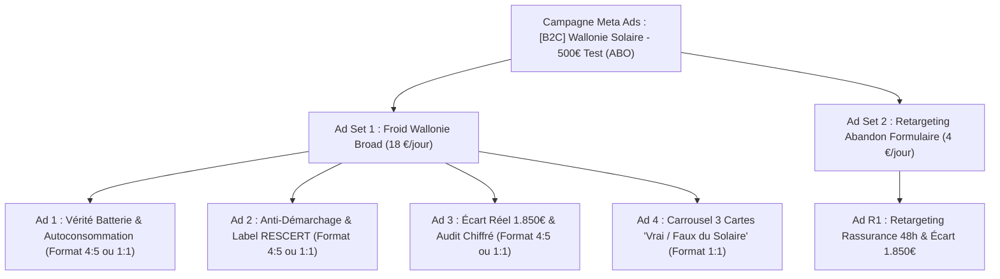

# Plan de Lancement & Configuration Meta Ads (Budget MAX 500 €)
**Aegis Solaire — Acquisition Résidentielle Wallonie (Lead Generation)**

---

## 1. Synthèse Exécutive & Objectifs Chiffrés

| Indicateur | Valeur Cible | Remarque / Benchmark Wallon |
|---|---|---|
| **Budget Total Strict** | **500,00 €** | Aucun dépassement possible |
| **Durée de Campagne** | **22 à 25 jours** | Rythme chirurgical de 20 € à 22 € / jour |
| **Format Publicitaire** | **100 % Statiques & Carrousel** | Aucun tournage vidéo requis |
| **Coût par Clic Cible (CPC)** | **0,75 € – 1,15 €** | Benchmarking marché solaire wallon |
| **Taux de Conversion Landing (CVR)** | **8,5 % – 13 %** | Optimisé sur `/devis-panneaux-solaires` |
| **Coût par Lead Cible (CPL)** | **20,00 € – 27,00 €** | Lead qualifié B2C propriétaire de maison |
| **Volume de Leads Attendus** | **18 à 25 leads** | Coordonnées complètes + adresse toiture validée |
| **Valeur Revente B2B Installateur** | **50 € – 65 € / lead** | Grille tarifaire Aegis Marketplace |
| **Revenu Brut Estimé** | **900 € – 1 625 €** | **ROI attendu : 180 % à 325 %** |

---

## 2. Architecture du Compte & Pacing Budgétaire

### Pourquoi ABO (Ad Set Budget Optimization) et NON CBO ?
Avec un budget restreint de 500 € (~22 €/jour), l'optimisation CBO (au niveau campagne) risquerait d'allouer prématurément 85 % du budget sur une seule annonce lors des premières 48h, sans laisser le temps à l'algorithme d'explorer les 3 angles.  
Le mode **ABO** permet de verrouiller le budget par ensemble et de tester de façon équitable les annonces en trafic froid et le retargeting.



### Répartition Détaillée du Budget (500 €)
1. **Ad Set 1 (TOFU - Trafic Froid Wallonie)** :
   - Budget : **18,00 € / jour**
   - Allocation totale : ~400 € sur 22 jours
   - But : Attirer les propriétaires wallons confrontés au tarif prosumer et générer le premier flux de conversions.
   - Rotation : 3 visuels statiques (Angle 1, Angle 2, Angle 3) + 1 Carrousel multi-cartes.
2. **Ad Set 2 (MOFU/BOFU - Retargeting Abandon Formulaire)** :
   - Budget : **4,00 € / jour**
   - Allocation totale : ~90 € sur 22 jours
   - But : Récupérer les personnes ayant visité la landing page sans valider l'étape 6.
   - Visuel : Angle 3 (Écart 1 850 € & Rassurance 48 h sans engagement).
3. **Marge de Sécurité** :
   - 10 € conservés comme tampon d'ajustement.

---

## 3. Paramétrage Précis dans Meta Ads Manager

### Niveau Campagne
- **Nom de Campagne** : `[AEGIS] B2C_SOLAIRE_WALLONIE_ABO_500E`
- **Catégorie Spéciale** : **Aucune** (Le photovoltaïque ne relève ni du crédit, ni de l'emploi, ni du logement locatif, à condition de ne pas axer la pub sur un "crédit bancaire").
- **Objectif de Campagne** : **PROSPECTS (Leads)**
- **Budget de campagne Advantage** : **Désactivé** (gestion au niveau Ad Set).

### Niveau Ad Set 1 (Trafic Froid Wallonie)
- **Nom de l'Ensemble** : `TOFU_Wallonie_Broad_Proprietaires_30-65`
- **Lieu de Conversion** : **Site Web**
- **Pixel Meta** : Sélectionner le Pixel Aegis Solaire (`NEXT_PUBLIC_META_PIXEL_ID`)
- **Événement de Conversion** : **Lead**
- **Budget Quotidien** : **18,00 €**
- **Stratégie d'Enchère** : **Volume le plus élevé** (Lowest Cost)
- **Lieux Géographiques (Inclusions strictes)** :
  - Belgique > Province de Liège
  - Belgique > Province de Namur
  - Belgique > Province du Brabant Wallon
  - Belgique > Province de Hainaut
  - Belgique > Province de Luxembourg
- **Âge** : **30 – 65+ ans** (élimine la quasi-totalité des non-décisionnaires et étudiants)
- **Langue** : **Français**
- **Ciblage Avancé Advantage+** : Activé sans restrictions d'intérêts. Le filtrage des propriétaires s'opère organiquement par les hooks visuels et le formulaire.
- **Placements** : **Placements Advantage+** (Recommandé par Meta).

### Niveau Ad Set 2 (Retargeting Chaud)
- **Nom de l'Ensemble** : `RETARGETING_Visiteurs_30J_NonLeads`
- **Budget Quotidien** : **4,00 €**
- **Audience Personnalisée** :
  - *Inclure* : Visiteurs de l'URL contenant `/devis-panneaux-solaires` au cours des 30 derniers jours.
  - *Exclure* : Événement Pixel `Lead` au cours des 180 derniers jours (ne jamais repayer pour un prospect déjà acquis).

---

## 4. Système de Tracking, Déduplication Pixel & CAPI

Le système technique a été directement intégré et validé dans le code source du projet Aegis Solaire.

### 1. Déduplication Parfaite Browser/Server via `eventID`
Pour garantir un **Event Match Quality (EMQ) supérieur à 8,5/10** et éviter que Meta ne compte les leads en double :
- **Côté Serveur (`lib/meta-capi.ts`)** : L'API envoie l'événement `Lead` sur Graph API **v22.0** avec `event_id = inserted.id`, `event_source_url = "https://www.aegissolaire.com/devis-panneaux-solaires"`, accompagné du hachage SHA-256 de l'email, du téléphone normalisé (+32), de l'IP et de l'User-Agent.
- **Côté Navigateur (`components/analytics/ad-tracking.tsx`)** : La fonction client transmet :
  ```javascript
  window.fbq("track", "Lead", eventData, { eventID: leadId })
  ```
- Meta fusionne automatiquement le signal navigateur et le signal serveur grâce à cet `eventID` unique.

### 2. Bandeau de Consentement & Mode Consent Revoke/Grant
- Un bandeau léger et conforme APD/ePrivacy (`components/analytics/cookie-consent-banner.tsx`) conditionne le Pixel.
- Par défaut, si l'internaute n'a pas encore cliqué sur "Accepter", le Pixel est initialisé en mode `fbq('consent', 'revoke')`.
- Dès acceptation, le mode `grant` s'active et le choix est mémorisé 6 mois dans le cookie `aegis_cookie_consent`.

### 3. Modèle d'URL Standardisé pour vos Annonces
À coller dans le champ **Paramètres d'URL** de chaque annonce Meta :
```text
utm_source=meta&utm_medium=cpc&utm_campaign={{campaign.name}}&utm_content={{ad.name}}&utm_term={{adset.name}}
```
**URL finale de destination** :
```text
https://aegissolaire.com/devis-panneaux-solaires
```

---

## 5. Pack Créatif Complet — Formats Statiques & Carrousel

Tous les fichiers créatifs finaux ont été compilés en haute définition (PNG) via Playwright et sont prêts à être téléversés depuis le dossier :  
📂 **`campagnes-meta/creatives-final/`**

---

### Annonce 1 : "Vérité Batterie & Autoconsommation"
*Fichiers : `ad_angle1_batterie_1080x1350.png` (Format 4:5 vertical) et `ad_angle1_batterie_1080x1080.png` (1:1 carré)*

#### Textes Publicitaires (Copies Meta)
- **Primary Text Court (Mobile sans 'Voir plus' — 118 car.)** :  
  Fin du compteur qui tourne à l'envers en Wallonie : découvrez votre taux d'autoconsommation et vos économies réelles.
- **Primary Text Long (378 car.)** :  
  « Le solaire n'est plus rentable depuis le compteur communicant » : c'est mathématiquement faux.  
  
  Avec une batterie bien dimensionnée, un foyer wallon moyen passe de 30 % à plus de 74 % d'autoconsommation, réduisant sa facture d'électricité de 1 480 €/an.  
  
  Avant de signer un devis opaque, réalisez votre simulation d'ingénierie impartiale en 45 secondes. 100 % gratuit et sans engagement.
- **Headline (Titre — max 40 car.)** : `Wallonie : calculez vos économies réelles`
- **Description (max 30 car.)** : `100 % gratuit & sans démarcheur`
- **Bouton d'Action (CTA)** : `Obtenir un devis` ou `En savoir plus`

---

### Annonce 2 : "Anti-Démarchage Agressif & Artisans Agréés RESCERT"
*Fichiers : `ad_angle2_rescert_1080x1350.png` (Format 4:5) et `ad_angle2_rescert_1080x1080.png` (1:1)*

#### Textes Publicitaires
- **Primary Text Court (112 car.)** :  
  Marre des commerciaux solaires insistants ? Comparez 3 installateurs certifiés RESCERT près de chez vous, 0 pression.
- **Primary Text Long (382 car.)** :  
  Vous avez déjà reçu ces appels de démarcheurs promettant des « panneaux solaires gratuits par la Région » ? C'est illégal et mensonger.  
  
  Pour réussir votre transition en Wallonie : exigez le label officiel RESCERT et comparez 3 artisans locaux sur un pied d'égalité.  
  
  Aegis protège vos coordonnées et sélectionne les meilleurs professionnels de votre province. Devis sous 48 h, 100 % transparent.
- **Headline** : `0 démarchage agressif. Comparez.`
- **Description** : `Sans engagement ni harcèlement`
- **Bouton d'Action (CTA)** : `Obtenir un devis`

---

### Annonce 3 : "Écart de Devis Réel (1 850 € sur une même toiture)"
*Fichiers : `ad_angle3_ecart1850_1080x1350.png` (Format 4:5) et `ad_angle3_ecart1850_1080x1080.png` (1:1)*

#### Textes Publicitaires
- **Primary Text Court (116 car.)** :  
  Jusqu'à 1 850 € d'écart constaté sur une même installation solaire en Wallonie. Comparez 3 devis avant de vous engager.
- **Primary Text Long (365 car.)** :  
  Combien doit réellement coûter une installation photovoltaïque de qualité en Wallonie en 2026 ?  
  
  Sur les chantiers audités par notre réseau, nous constatons jusqu'à 1 850 € de différence pour des panneaux et onduleurs équivalents.  
  
  Ne payez pas la marge excessive d'intermédiaires. Obtenez 3 propositions chiffrées d'installateurs agréés de votre commune en 45 secondes. 100 % gratuit.
- **Headline** : `1 850 € d'écart sur le même devis`
- **Description** : `Simulation gratuite en 45 secondes`
- **Bouton d'Action (CTA)** : `Obtenir un devis`

---

### Annonce 4 : Carrousel 3 Cartes "Le Vrai / Faux du Solaire Wallon"
*Fichiers : `carrousel_carte1_1080x1080.png`, `carrousel_carte2_1080x1080.png`, `carrousel_carte3_1080x1080.png`*

- **Primary Text Global** :  
  Tarif prosumer, fin du compteur qui tourne à l'envers, promesses de gratuité... Décryptage de 3 mythes solaires en Wallonie en 2026. Glissez pour découvrir la réalité chiffrée.
- **Titres de Cartes (Headlines par slide)** :
  - Carte 1 : `Mythe #1 : Rentabilité avec batterie`
  - Carte 2 : `Mythe #2 : Panneaux gratuits ? Faux.`
  - Carte 3 : `Conseil #3 : Économisez jusqu'à 1.850 €`
- **URL de Destination de chaque Carte** :  
  `https://aegissolaire.com/devis-panneaux-solaires?utm_source=meta&utm_medium=cpc&utm_campaign={{campaign.name}}&utm_content=carrousel_vrai_faux`

---

## 6. Protocole de Suivi & Règles de Pilotage Budgétaire (KILL / SCALE)

Avec 500 €, chaque euro compte. Suivez ce protocole au jour le jour :

### Calendrier de Décision
- **J+2 (Environ 40 € dépensés)** :
  - Vérifier le **CTR lien** (> 1,2 % attendu). Si une annonce est sous 0,8 % de CTR après 500 impressions, la **couper** immédiatement.
  - Vérifier le **CPC** (< 1,20 € attendu).
- **J+4 (Environ 90 € dépensés)** :
  - **Règle KILL** : Si une annonce a dépensé **45 € (soit 1,8x le CPL cible) avec 0 lead généré**, la mettre en **PAUSE définitive**.
  - Si une annonce génère des leads à un CPL < 22 €, la **GARDER active**.
- **J+7 (Environ 155 € dépensés)** :
  - Identifier le format et l'angle gagnant (Statique vs Carrousel).
  - Réallouer l'essentiel du budget de l'Ad Set 1 sur les 2 annonces les plus performantes.
- **J+15 à J+22 (Fin du budget de 500 €)** :
  - L'Ad Set 2 de Retargeting ramasse les visiteurs indécis au CPL le plus bas (< 15 €).

---

## 7. Checklist "Go / No-Go" Avant Lancement

- [x] **Tracking Pixel client** configuré avec transmission de `eventID` pour déduplication.
- [x] **API Meta Conversions (CAPI)** activée en Graph API v22+ avec `event_source_url` et hachage SHA-256.
- [x] **Bandeau de consentement cookies** conforme APD/ePrivacy déployé avec bascule `grant/revoke`.
- [x] **Capture des UTMs** opérationnelle sur `/devis-panneaux-solaires` et enregistrée dans Supabase.
- [x] **Responsivité smartphone** auditée sans débordement, typographie 16px sur inputs contre le zoom iOS Safari.
- [x] **Créatifs finaux PNG** générés en 1080x1080 et 1080x1350 disponibles dans `campagnes-meta/creatives-final/`.
- [x] **Guide Canva / Figma** rédigé dans `campagnes-meta/4-BRIEFS-CANVA-ET-CARROUSEL.md`.
- [x] **Structure ABO** paramétrée à 18 €/j (TOFU) et 4 €/j (Retargeting) pour un total strict de 500 €.
