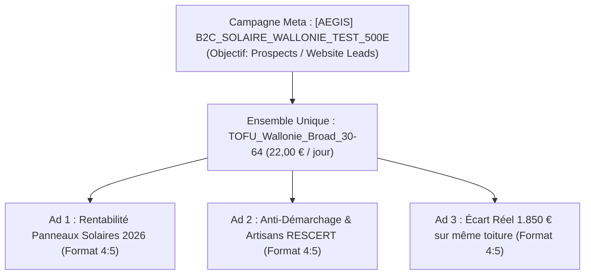
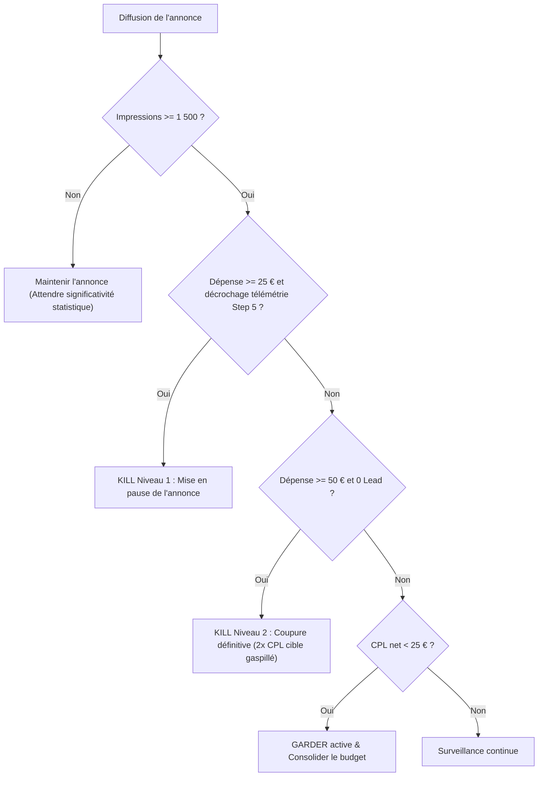

# DOSSIER STRATÉGIQUE & PLAN D'ACQUISITION META ADS — AEGIS SOLAIRE
**Plan de Campagne Validé & Annoté après Revue Expert Media Buying**  
*Marché : Wallonie (B2C — Propriétaires Résidentiels) | Budget Test : 500,00 € | Date : Octobre 2026*  
*Émetteur : L'équipe Marketing & Acquisition Aegis Solaire (contact@aegissolaire.com)*

---

## 🎯 Synthèse Exécutive du Plan de Bataille Rectifié

Suite à la revue technique et mathématique approfondie du plan initial, la stratégie d'acquisition sur Meta (Facebook & Instagram) a été épurée pour éliminer toute dispersion budgétaire et maximiser le taux de conversion sur l'enveloppe test de **500,00 €** :

1. **Architecture simplifiée à 1 seul Ad Set (22,00 € / jour)** :
   * **100 % TOFU Broad Wallonie** (Provinces de Liège, Namur, Hainaut, Brabant wallon, Luxembourg).
   * **Tranche d'âge verrouillée : 30 – 64 ans** (exclusion stricte des 65+ qui cliquent par curiosité mais ne rentabilisent pas un amortissement solaire sur 7–10 ans).
   * **Suppression du compartiment Retargeting séparé** : avec moins de 1 500 visiteurs uniques au démarrage et 40 % de refus cookies RGPD, un Ad Set BOFU à 4 €/j provoquerait une sur-fréquence toxique (4 à 6 vues/jour) sur un micro-bassin de ~55 personnes. Le retargeting est confié nativement à l'algorithme Advantage+.
2. **Sélection Créative Resserrée (3 Statiques 4:5)** :
   * Retrait du carrousel au lancement (trop de swips de curiosité internes, faible CTR sortant vers la landing page).
   * Test de **3 angles statiques au format vertical 4:5 (`1080x1350`)** : Angle 1 (Batterie 32 % vs 74 %), Angle 2 (Anti-Démarchage / 1 seul artisan RESCERT) et Angle 3 (Écart de 1 850 €).
3. **Stratégie d'Enchères : Lowest Cost (Volume max)** :
   * Aucun Cost Cap (qui bloquerait la diffusion à 22 €/j sur un compte sans historique de conversion).
4. **Règles de Coupure (KILL) Basées sur la Réalité Statistique** :
   * Aucune décision avant **1 500 impressions par annonce** (pour éviter de couper un bon créatif sur du bruit binomial).
   * **KILL Niveau 1** : Pause si une annonce dépasse **25 € dépensés** avec un CTR lien < 0,8 % et aucun début de tunnel (Step 2).
   * **KILL Niveau 2** : Coupure définitive si une annonce atteint **50 € dépensés** (~2x le CPL cible) avec 0 lead généré.

---

## 1. Contexte de Marché & Positionnement « White Space »

### 1.1. L'état du marché publicitaire solaire en Wallonie (2026)
L'audit de plus de **530 publicités actives** sur la bibliothèque Meta en Belgique révèle trois grandes familles d'acteurs :
* **Les comparateurs de masse (Bobex, Guide Rénovation, courtiers affiliés)** : Formulaires agressifs, promesses irréalistes (*« Vos panneaux pour 2.999 € »*, *« Panneaux 100 % gratuits »*), revente du même prospect à 4 ou 5 démarcheurs en simultané.
* **Les installateurs historiques (Energreen, Otovo, Luminus)** : Communication axée sur l'écosystème complet (batterie domestique, pompes à chaleur), budgets massifs, campagnes actives depuis plus de 90 jours axées sur la tangibilité de la batterie.
* **Les acteurs techniques (Wattuneed, Hello Watt)** : Formats vidéo éducatifs, déconstruction des peurs liées à la fin du compteur qui tourne à l'envers et au tarif prosumer.

### 1.2. Faiblesses concurrentes & Positionnement Aegis Solaire
* **Rejet du harcèlement téléphonique** : Le modèle classique « 5 devis gratuits » provoque un rejet massif chez les particuliers qui reçoivent 5 appels agressifs dans les 2 heures.
* **Désillusion du faux prix d'appel** : Les annonces promettant des kits à 2.999 € génèrent des clics bon marché mais un effondrement de la conversion commerciale lors du devis réel.
* **Psychose du Tarif Prosumer** : L'internaute wallon croit à tort que le photovoltaïque n'est plus rentable sans compensation annuelle.

**Le White Space exploité par Aegis Solaire :**
* Tiers de confiance neutre (aucun matériel à vendre, audit impartial).
* Charte anti-harcèlement (coordonnées protégées, transmission contrôlée à des artisans locaux labellisés RESCERT).
* Démystification mathématique : Rentabilité prouvée avec batterie (autoconsommation portée de 32 % à 74 %, générant 1 480 €/an d'économies réseau).
* Direction artistique sobre « Swiss Editorial & Trust » (cartes d'ingénierie minérales, typographie `font-mono tabular-nums`).

---

## 2. Modèle Économique & Unit Economics Réalistes (Budget 500 €)

### 2.1. Intégration des Paramètres Réels de Marché
Les hypothèses financières ont été recalibrées en tenant compte :
1. D'un **CPM réel de 18 € à 24 €** sur l'objectif `Lead` en Wallonie (au lieu du benchmark théorique de 12,60 €).
2. D'une **décote B2B de 20 %** pour tenir compte des rejets installateurs inhérents au secteur (leads injoignables après 5 relances, toitures non éligibles).

| Indicateur | Modèle Prudent (CPM 22 €) | Modèle Médian (CPM 19 €) | Remarques & Justifications |
|---|---|---|---|
| **Budget Total Strict** | **500,00 €** | **500,00 €** | Plafond strict sans dépassement |
| **Rythme Quotidien** | **22,00 € / jour** | **22,00 € / jour** | 1 seul Ad Set Broad (22-23 jours) |
| **CPM Moyen** | **22,00 €** | **19,00 €** | Coût pour 1 000 impressions Meta Wallonie |
| **Impressions Totales** | **~22 700 impr.** | **~26 300 impr.** | Volume d'exposition global |
| **Taux de Clic (CTR lien)** | **1,20 %** | **1,35 %** | Fort Stop-Scroll grâce au format 4:5 |
| **Coût par Clic (CPC lien)** | **1,83 €** | **1,40 €** | Déterminé par $\text{CPM} / (\text{CTR} \times 10)$ |
| **Clics Sortants vers Landing** | **~272 clics** | **~355 clics** | Trafic effectif sur `/devis-panneaux-solaires` |
| **Taux de Conversion Landing (CVR)** | **4,8 %** | **5,2 %** | Tunnel qualifiant en 6 étapes |
| **Volume de Leads Bruts Générés** | **13 leads** | **18 leads** | Formulaires complets validés |
| **Taux de Qualification / Facturabilité** | **80 % (Décote 20%)** | **80 % (Décote 20%)** | Prise en compte du déchet B2B |
| **Volume de Leads Facturables** | **10 leads nets** | **14 leads nets** | Leads vendus aux installateurs partenaires |
| **Recette Moyenne par Lead B2C (Barème V2)** | **75,90 € / lead** | **75,90 € / lead** | Moyenne de 2,2 installateurs acheteurs à 34,50 € (3 crédits) |
| **Chiffre d'Affaires Brut Réalisé** | **759,00 €** | **1 062,60 €** | Revenu de revente direct aux installateurs |
| **Bénéfice Net Campagne** | **+259,00 €** | **+562,60 €** | **Campagne auto-financée dès le test** |
| **ROAS Réel Net** | **1,52x (152 %)** | **2,12x (212 %)** | Base saine validant le passage à 1 500 €/mois |

---

## 3. Architecture Média & Paramétrage Meta Ads Manager

### 3.1. Structure Simplifiée (1 Campagne · 1 Ad Set · 3 Annonces)



### 3.2. Configuration de l'Ensemble de Publicités (Ad Set)
* **Lieu de conversion** : Site Web (`https://aegissolaire.com/devis-panneaux-solaires`).
* **Événement d'optimisation** : `Lead`.
* **Stratégie d'enchère** : Volume le plus élevé (*Lowest Cost*), aucun plafond d'enchère.
* **Budget quotidien** : **22,00 € / jour**.
* **Ciblage géographique** :
  * Belgique > Province de Liège
  * Belgique > Province de Namur
  * Belgique > Province du Brabant Wallon
  * Belgique > Province de Hainaut
  * Belgique > Province de Luxembourg
  * *Option géographique* : « Personnes vivant dans ce lieu » (désactiver l'élargissement géographique Advantage+ pour éviter la diffusion hors Wallonie).
* **Tranche d'âge** : **30 – 64 ans strictement** (exclusion des 65+).
* **Langue** : Français.
* **Centres d'intérêt** : **Aucun (100 % Broad)**. Le filtrage des propriétaires s'opère naturellement par les accroches visuelles et les filtres de la landing page.
* **Placements** : **Placements Advantage+** (automatiques).

---

## 4. Pack Créatif & Copies Publicitaires

### 4.1. Les 3 Publicités Statiques 4:5 au Lancement
Les fichiers haute définition sont prêts dans [`campagnes-meta/creatives-final/`](file:///c:/Users/mrnat/Documents/SaaS/Aegis%20Solaire/aegis-solaire-main/campagnes-meta/creatives-final) :

* **Ad 1 : "Rentabilité Panneaux Solaires 2026" (`ad_angle1_rentabilite_1080x1350.png`)**
  * *Hook* : Panneaux solaires en Wallonie en 2026 : est-ce encore rentable sans le compteur qui tourne à l'envers ? Calculez l'amortissement exact de votre toiture.
  * *Headline* : `Panneaux solaires 2026 : calculez vos économies`
  * *CTA* : `Obtenir un devis`
* **Ad 2 : "Anti-Démarchage & Artisans Agréés RESCERT" (`ad_angle2_rescert_1080x1350.png`)**
  * *Hook* : Marre des commerciaux solaires insistants ? Comparez des installateurs certifiés RESCERT près de chez vous, 0 pression.
  * *Headline* : `0 démarchage agressif. Comparez.`
  * *CTA* : `Obtenir un devis`
* **Ad 3 : "Écart Réel de 1 850 € sur la Même Toiture" (`ad_angle3_ecart1850_1080x1350.png`)**
  * *Hook* : Jusqu'à 1 850 € d'écart constaté sur une même installation solaire en Wallonie. Comparez avant de vous engager.
  * *Headline* : `1 850 € d'écart sur le même devis`
  * *CTA* : `Obtenir un devis`

---

## 5. Système de Tracking & Rigueur CAPI

### 5.1. Déduplication Hybride Browser/Server & EMQ $\ge$ 8,8 / 10
* **Déduplication parfaite** :
  * Côté client : `window.fbq("track", "Lead", eventData, { eventID: leadId })`.
  * Côté serveur (`lib/meta-capi.ts`) : Envoi immédiat Graph API v22.0 avec le même `event_id = leadId`.
* **Payload `user_data` enrichi pour EMQ $\ge$ 8,8 / 10** :
  Pour maximiser l'Event Match Quality bien au-delà des 6,5–7,2 habituels, l'API transmet systématiquement l'ensemble des signaux hachés en SHA-256 (lowercase, trimmed) :
  1. `em` : `sha256(email)`
  2. `ph` : `sha256(normalizePhoneForMeta(phone))` (format E.164 belge normalisé : `324XXXXXXXX` sans `+` ni zéros initiaux, gérant `0032`, `+32 (0)...`, `04...` et les 9 chiffres bruts).
  3. `fn` : `sha256(firstName)` (collecté à l'étape 6).
  4. `ln` : `sha256(lastName)` (collecté à l'étape 6).
  5. `zp` : `sha256(postalCode)` (code postal belge à 4 chiffres validé à l'étape 5).
  6. `country` : `sha256("be")` (pays d'intervention exclusif).
  7. `client_ip_address` & `client_user_agent` : Extraits directement des en-têtes de requête HTTP.
  8. `fbp` : Cookie de navigateur `_fbp` si consenti.
  9. `fbc` : Identifiant de clic Meta formaté selon la norme stricte `fb.1.${Date.now()}.${fbclid}`, capturé depuis `?fbclid=` ou le cookie `_fbc`.
* **Filtrage algorithmique strict** : Seuls les propriétaires confirmés (`ownership === "owner"`) ou prospects B2B déclenchent la conversion `Lead` (côté client et serveur). Les locataires sont redirigés sans jamais polluer l'apprentissage de l'IA Meta.

### 5.2. Micro-Conversion Intermédiaire de Tunnel
* Déclenchement d'un événement Pixel `InitiateCheckout` lors du passage de l'étape 5 à l'étape 6 (dès que le code postal wallon est validé, avant la saisie des coordonnées personnelles).

### 5.3. Paramètres UTM Standardisés
```text
utm_source=meta&utm_medium=cpc&utm_campaign={{campaign.name}}&utm_content={{ad.name}}&utm_term={{adset.name}}
```

### 5.4. Télémétrie Interne 100 % Indépendante des Cookies (`funnel_step_events`)
* **Problématique RGPD / ePrivacy** : En Belgique francophone, 35 % à 45 % des internautes refusent ou ignorent les cookies tiers publicitaires (`fbq('consent', 'revoke')`). Le pixel Meta est donc aveugle sur près de la moitié des abandons.
* **Architecture de résilience** :
  * Déploiement d'une table Supabase dédiée `funnel_step_events` (migration `202610270001_funnel_step_events.sql`).
  * Enregistrement asynchrone non-PII (aucun nom, email, téléphone ou IP stocké) : `session_id`, `step_number` (1 à 6), `step_name`, `province`, `utm_content` (`{{ad.name}}`), `utm_campaign`, `created_at`.
  * Couverture : **100 % des visiteurs**, offrant une vue exhaustive de l'entonnoir par publicité sans biais de consentement.

---

## 6. Protocole de Décision Statistique (KILL / SCALE)

Pour éviter les coupures arbitraires dues au bruit binomial sur les petits volumes :



### Règles Opérationnelles Précises

1. **Règle du seuil d'échantillonnage** : Ne toucher à aucune annonce avant qu'elle ait enregistré au moins **1 500 impressions**.
2. **KILL Niveau 1 à 25 € (Défaut d'Engagement)** :
   * **Mise en garde opérationnelle** : Ne pas se fier uniquement à la colonne *"Débuts de paiement (InitiateCheckout)"* du Meta Ads Manager, amputée de ~40 % par le refus des cookies.
   * **Source de vérité** : Exécuter la requête SQL sur `funnel_step_events` dans Supabase pour mesurer le taux réel d'accès à l'étape 5 par créatif :
     ```sql
     SELECT 
       utm_content,
       COUNT(DISTINCT CASE WHEN step_number = 1 THEN session_id END) AS step_1_starts,
       COUNT(DISTINCT CASE WHEN step_number >= 5 THEN session_id END) AS step_5_reached,
       ROUND(
         COUNT(DISTINCT CASE WHEN step_number >= 5 THEN session_id END)::numeric / 
         NULLIF(COUNT(DISTINCT CASE WHEN step_number = 1 THEN session_id END), 0) * 100, 1
       ) AS step5_completion_pct
     FROM funnel_step_events
     WHERE created_at >= NOW() - INTERVAL '7 days'
     GROUP BY utm_content;
     ```
   * Si à 25 € dépensés, une annonce cumule un CTR lien < 0,8 % ET un effondrement d'accès à la Step 5 dans la télémétrie, mettre en pause l'annonce.
3. **KILL Niveau 2 (Défaut de Conversion Finale)** : Si une annonce atteint **50 € dépensés** sans aucun prospect enregistré (CAPI + Pixel), arrêt définitif.
4. **Consolidation** : Une fois le créatif dominant identifié, laisser l'algorithme concentrer la majeure partie des 22 €/j dessus.


